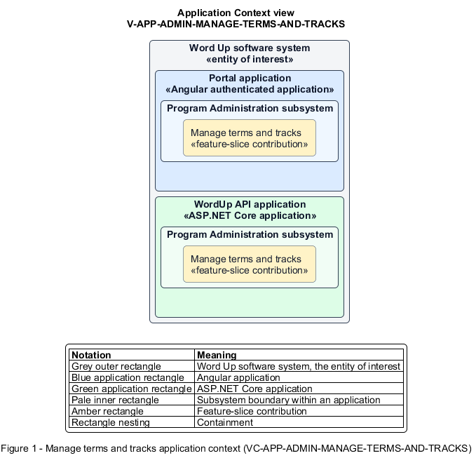

# Manage terms and tracks

## Identification and scope

The Word Up software system is the entity of interest (EoI). The Manage terms and tracks feature slice (`FS-ADMIN-MANAGE-TERMS-AND-TRACKS`) is an architecture description element in the Program Administration subsystem.

| Item | Identification |
| --- | --- |
| Participating applications | Portal application; WordUp API application |
| Architecture view | Application Context view (`V-APP-ADMIN-MANAGE-TERMS-AND-TRACKS`) |
| Governing viewpoint | Application Context viewpoint (`VP-APP-CONTEXT`) |
| View component | Nested Application Context component (`VC-APP-ADMIN-MANAGE-TERMS-AND-TRACKS`) |

This focused description addresses feature scope, behavior, application context, and requirement correspondences. It does not claim conformance as a complete architecture description.

## Overview

The Manage terms and tracks feature slice allows administrators maintain program cycles and pause new work in a track without erasing progress.

## Application context

The Application Context view (`V-APP-ADMIN-MANAGE-TERMS-AND-TRACKS`) applies the Application Context viewpoint (`VP-APP-CONTEXT`) to the Word Up software system. The viewpoint frames the application-location concern (`C-APP-LOCATION`). The view component (`VC-APP-ADMIN-MANAGE-TERMS-AND-TRACKS`) uses the nested-containment model kind.

Nested rectangles identify the EoI, each participating application, the subsystem boundary, and the feature-slice contribution. Figure 1 presents the view component.

*Figure 1 — Application Context view: the Manage terms and tracks feature slice within the participating Word Up applications.*

## Behavior

- **Entry.** An administrator creates or updates a dated term or enables or disables a track.
- **Processing.** The server validates term ranges and statuses and persists track availability; disabling blocks new assignments while retaining existing youth progress and historical data.
- **Result.** Scheduling, consent renewal, cohort recurrence, and assignment choices use current program configuration.

## Scope boundary

Authoring track content and configuring consent wording are separate slices.

## Correspondences

The requirement-trace correspondence method (`M-REQ-TRACE`) relates stable L2 requirement identifiers to feature slices. The Manage terms and tracks requirement correspondence (`COR-REQ-ADMIN-MANAGE-TERMS-AND-TRACKS`) records the following relationships.

| Requirement | Relationship |
| --- | --- |
| `L2-ADMIN-006` | Primary requirement |
| `L2-CURRIC-001` | Dependency |
| `L2-CONSENT-001` | Dependency |
