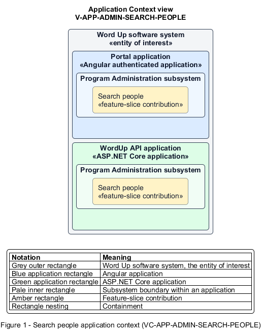

# Search people

## Identification and scope

The Word Up software system is the entity of interest (EoI). The Search people feature slice (`FS-ADMIN-SEARCH-PEOPLE`) is an architecture description element in the Program Administration subsystem.

| Item | Identification |
| --- | --- |
| Participating applications | Portal application; WordUp API application |
| Architecture view | Application Context view (`V-APP-ADMIN-SEARCH-PEOPLE`) |
| Governing viewpoint | Application Context viewpoint (`VP-APP-CONTEXT`) |
| View component | Nested Application Context component (`VC-APP-ADMIN-SEARCH-PEOPLE`) |

This focused description addresses feature scope, behavior, application context, and requirement correspondences. It does not claim conformance as a complete architecture description.

## Overview

The Search people feature slice allows a Program Administrator find organization members by text, role, or cohort.

## Application context

The Application Context view (`V-APP-ADMIN-SEARCH-PEOPLE`) applies the Application Context viewpoint (`VP-APP-CONTEXT`) to the Word Up software system. The viewpoint frames the application-location concern (`C-APP-LOCATION`). The view component (`VC-APP-ADMIN-SEARCH-PEOPLE`) uses the nested-containment model kind.

Nested rectangles identify the EoI, each participating application, the subsystem boundary, and the feature-slice contribution. Figure 1 presents the view component.

*Figure 1 — Application Context view: the Search people feature slice within the participating Word Up applications.*

## Behavior

- **Entry.** An administrator opens People and applies search terms or role and cohort filters.
- **Processing.** The server returns paginated rows with role, cohort, mentor, status, and last activity within performance budgets. The responsive interface renders tables or labelled cards and offers an invitation action for empty results.
- **Result.** The administrator can select the intended person or begin inviting someone absent.

## Scope boundary

Editing the selected person's record is a separate slice.

## Correspondences

The requirement-trace correspondence method (`M-REQ-TRACE`) relates stable L2 requirement identifiers to feature slices. The Search people requirement correspondence (`COR-REQ-ADMIN-SEARCH-PEOPLE`) records the following relationships.

| Requirement | Relationship |
| --- | --- |
| `L2-ADMIN-001` | Primary requirement |
| `L2-NFR-008` | Dependency |
| `L2-NFR-009` | Dependency |
