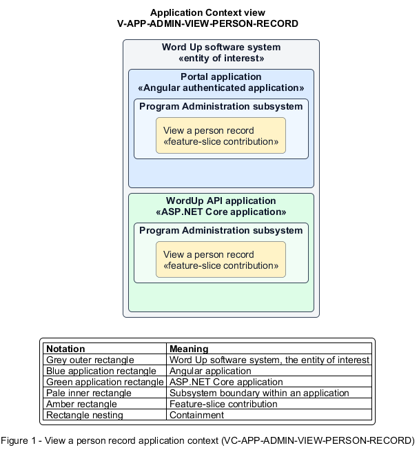

# View a person record

## Identification and scope

The Word Up software system is the entity of interest (EoI). The View a person record feature slice (`FS-ADMIN-VIEW-PERSON-RECORD`) is an architecture description element in the Program Administration subsystem.

| Item | Identification |
| --- | --- |
| Participating applications | Portal application; WordUp API application |
| Architecture view | Application Context view (`V-APP-ADMIN-VIEW-PERSON-RECORD`) |
| Governing viewpoint | Application Context viewpoint (`VP-APP-CONTEXT`) |
| View component | Nested Application Context component (`VC-APP-ADMIN-VIEW-PERSON-RECORD`) |

This focused description addresses feature scope, behavior, application context, and requirement correspondences. It does not claim conformance as a complete architecture description.

## Overview

The View a person record feature slice provides administrators one authorized overview of a person's program and account context.

## Application context

The Application Context view (`V-APP-ADMIN-VIEW-PERSON-RECORD`) applies the Application Context viewpoint (`VP-APP-CONTEXT`) to the Word Up software system. The viewpoint frames the application-location concern (`C-APP-LOCATION`). The view component (`VC-APP-ADMIN-VIEW-PERSON-RECORD`) uses the nested-containment model kind.

Nested rectangles identify the EoI, each participating application, the subsystem boundary, and the feature-slice contribution. Figure 1 presents the view component.

*Figure 1 — Application Context view: the View a person record feature slice within the participating Word Up applications.*

## Behavior

- **Entry.** An administrator selects a person from the directory.
- **Processing.** For youth, the server composes profile, guardian and consent, progress, attendance, notes, and account tabs under privacy rules; other roles receive their applicable record fields.
- **Result.** The administrator can understand current state and choose a permitted lifecycle action.

## Scope boundary

Deactivation, role change, password reset, and removal execute through the account-lifecycle slice.

## Correspondences

The requirement-trace correspondence method (`M-REQ-TRACE`) relates stable L2 requirement identifiers to feature slices. The View a person record requirement correspondence (`COR-REQ-ADMIN-VIEW-PERSON-RECORD`) records the following relationships.

| Requirement | Relationship |
| --- | --- |
| `L2-ADMIN-002` | Primary requirement |
| `L2-AUTH-010` | Dependency |
| `L2-CONSENT-004` | Dependency |
