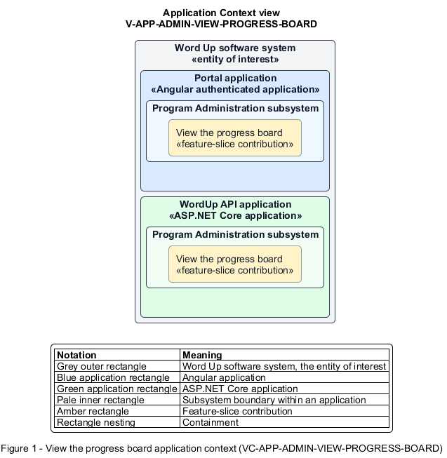

# View the progress board

## Identification and scope

The Word Up software system is the entity of interest (EoI). The View the progress board feature slice (`FS-ADMIN-VIEW-PROGRESS-BOARD`) is an architecture description element in the Program Administration subsystem.

| Item | Identification |
| --- | --- |
| Participating applications | Portal application; WordUp API application |
| Architecture view | Application Context view (`V-APP-ADMIN-VIEW-PROGRESS-BOARD`) |
| Governing viewpoint | Application Context viewpoint (`VP-APP-CONTEXT`) |
| View component | Nested Application Context component (`VC-APP-ADMIN-VIEW-PROGRESS-BOARD`) |

This focused description addresses feature scope, behavior, application context, and requirement correspondences. It does not claim conformance as a complete architecture description.

## Overview

The View the progress board feature slice replaces the cohort spreadsheet with a live youth-by-module progress matrix.

## Application context

The Application Context view (`V-APP-ADMIN-VIEW-PROGRESS-BOARD`) applies the Application Context viewpoint (`VP-APP-CONTEXT`) to the Word Up software system. The viewpoint frames the application-location concern (`C-APP-LOCATION`). The view component (`VC-APP-ADMIN-VIEW-PROGRESS-BOARD`) uses the nested-containment model kind.

Nested rectangles identify the EoI, each participating application, the subsystem boundary, and the feature-slice contribution. Figure 1 presents the view component.

*Figure 1 — Application Context view: the View the progress board feature slice within the participating Word Up applications.*

## Behavior

- **Entry.** An administrator chooses a cohort and track.
- **Processing.** The server aggregates each youth's module state, quiz average, overall percentage, and cohort averages; the UI renders a bounded horizontally scrollable matrix and can refresh from canonical progress updates.
- **Result.** Staff can compare current progress across the entire selected cohort.

## Scope boundary

The Export Filtered Data feature slice generates CSV and PDF artifacts.

## Correspondences

The requirement-trace correspondence method (`M-REQ-TRACE`) relates stable L2 requirement identifiers to feature slices. The View the progress board requirement correspondence (`COR-REQ-ADMIN-VIEW-PROGRESS-BOARD`) records the following relationships.

| Requirement | Relationship |
| --- | --- |
| `L2-ADMIN-004` | Primary requirement |
| `L2-REPORT-003` | Dependency |
| `L2-NFR-005` | Dependency |
| `L2-NFR-009` | Dependency |
