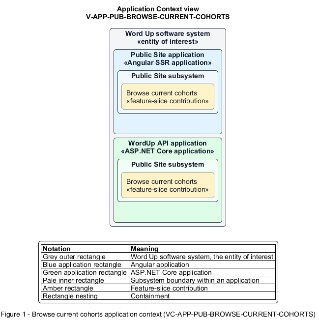

# Browse current cohorts

## Identification and scope

The Word Up software system is the entity of interest (EoI). The Browse current cohorts feature slice (`FS-PUB-BROWSE-CURRENT-COHORTS`) is an architecture description element in the Public Site subsystem.

| Item | Identification |
| --- | --- |
| Participating applications | Public Site application; WordUp API application |
| Architecture view | Application Context view (`V-APP-PUB-BROWSE-CURRENT-COHORTS`) |
| Governing viewpoint | Application Context viewpoint (`VP-APP-CONTEXT`) |
| View component | Nested Application Context component (`VC-APP-PUB-BROWSE-CURRENT-COHORTS`) |

This focused description addresses feature scope, behavior, application context, and requirement correspondences. It does not claim conformance as a complete architecture description.

## Overview

The Browse current cohorts feature slice allows a visitor see current program opportunities without exposing participant records.

## Application context

The Application Context view (`V-APP-PUB-BROWSE-CURRENT-COHORTS`) applies the Application Context viewpoint (`VP-APP-CONTEXT`) to the Word Up software system. The viewpoint frames the application-location concern (`C-APP-LOCATION`). The view component (`VC-APP-PUB-BROWSE-CURRENT-COHORTS`) uses the nested-containment model kind.

Nested rectangles identify the EoI, each participating application, the subsystem boundary, and the feature-slice contribution. Figure 1 presents the view component.

*Figure 1 — Application Context view: the Browse current cohorts feature slice within the participating Word Up applications.*

## Behavior

- **Entry.** An anonymous visitor opens the public cohort content.
- **Processing.** The server reads the authoritative cohort records and publishes neighbourhood, dates, lead mentor, and status consistently across public pages.
- **Result.** The visitor knows where and when cohorts operate and whether each is currently available.

## Scope boundary

Cohort administration and applicant placement are authenticated features.

## Correspondences

The requirement-trace correspondence method (`M-REQ-TRACE`) relates stable L2 requirement identifiers to feature slices. The Browse current cohorts requirement correspondence (`COR-REQ-PUB-BROWSE-CURRENT-COHORTS`) records the following relationships.

| Requirement | Relationship |
| --- | --- |
| `L2-PUB-002` | Primary requirement |
| `L2-ADMIN-003` | Dependency |
