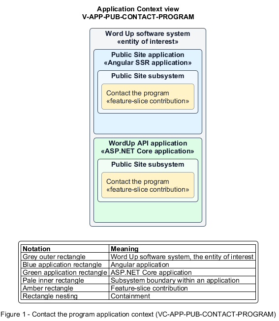

# Contact the program

## Identification and scope

The Word Up software system is the entity of interest (EoI). The Contact the program feature slice (`FS-PUB-CONTACT-PROGRAM`) is an architecture description element in the Public Site subsystem.

| Item | Identification |
| --- | --- |
| Participating applications | Public Site application; WordUp API application |
| Architecture view | Application Context view (`V-APP-PUB-CONTACT-PROGRAM`) |
| Governing viewpoint | Application Context viewpoint (`VP-APP-CONTEXT`) |
| View component | Nested Application Context component (`VC-APP-PUB-CONTACT-PROGRAM`) |

This focused description addresses feature scope, behavior, application context, and requirement correspondences. It does not claim conformance as a complete architecture description.

## Overview

The Contact the program feature slice allows a visitor send a general inquiry and receive acknowledgement.

## Application context

The Application Context view (`V-APP-PUB-CONTACT-PROGRAM`) applies the Application Context viewpoint (`VP-APP-CONTEXT`) to the Word Up software system. The viewpoint frames the application-location concern (`C-APP-LOCATION`). The view component (`VC-APP-PUB-CONTACT-PROGRAM`) uses the nested-containment model kind.

Nested rectangles identify the EoI, each participating application, the subsystem boundary, and the feature-slice contribution. Figure 1 presents the view component.

*Figure 1 — Application Context view: the Contact the program feature slice within the participating Word Up applications.*

## Behavior

- **Entry.** A visitor submits name, email, topic, and message on Contact.
- **Processing.** Client and server validate required fields and email format, sanitize free text, persist the inquiry, and present a successful acknowledgement.
- **Result.** Program staff have a contactable inquiry and the visitor knows it was received.

## Scope boundary

Volunteer screening interest and donation processing are separate public slices.

## Correspondences

The requirement-trace correspondence method (`M-REQ-TRACE`) relates stable L2 requirement identifiers to feature slices. The Contact the program requirement correspondence (`COR-REQ-PUB-CONTACT-PROGRAM`) records the following relationships.

| Requirement | Relationship |
| --- | --- |
| `L2-PUB-003` | Primary requirement |
| `L2-NFR-001` | Dependency |
