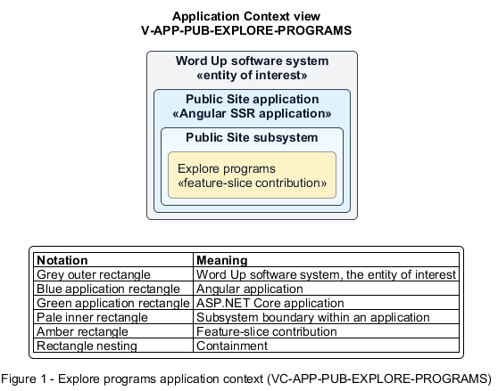

# Explore programs

## Identification and scope

The Word Up software system is the entity of interest (EoI). The Explore programs feature slice (`FS-PUB-EXPLORE-PROGRAMS`) is an architecture description element in the Public Site subsystem.

| Item | Identification |
| --- | --- |
| Participating applications | Public Site application |
| Architecture view | Application Context view (`V-APP-PUB-EXPLORE-PROGRAMS`) |
| Governing viewpoint | Application Context viewpoint (`VP-APP-CONTEXT`) |
| View component | Nested Application Context component (`VC-APP-PUB-EXPLORE-PROGRAMS`) |

This focused description addresses feature scope, behavior, application context, and requirement correspondences. It does not claim conformance as a complete architecture description.

## Overview

The Explore programs feature slice helps a visitor understand the available learning tracks and mentorship model.

## Application context

The Application Context view (`V-APP-PUB-EXPLORE-PROGRAMS`) applies the Application Context viewpoint (`VP-APP-CONTEXT`) to the Word Up software system. The viewpoint frames the application-location concern (`C-APP-LOCATION`). The view component (`VC-APP-PUB-EXPLORE-PROGRAMS`) uses the nested-containment model kind.

Nested rectangles identify the EoI, each participating application, the subsystem boundary, and the feature-slice contribution. Figure 1 presents the view component.

*Figure 1 — Application Context view: the Explore programs feature slice within the participating Word Up applications.*

## Behavior

- **Entry.** An anonymous visitor opens Programs.
- **Processing.** The page presents Bible and Leadership and Coding for Kingdom tracks with modules and outcome badges, alongside weekly check-ins, reflection review, and extra-support aspects of mentorship.
- **Result.** The visitor can determine whether the program's learning and support model fits their interest.

## Scope boundary

Applying, cohort availability, and curriculum participation are separate journeys.

## Correspondences

The requirement-trace correspondence method (`M-REQ-TRACE`) relates stable L2 requirement identifiers to feature slices. The Explore programs requirement correspondence (`COR-REQ-PUB-EXPLORE-PROGRAMS`) records the following relationships.

| Requirement | Relationship |
| --- | --- |
| `L2-PUB-002` | Primary requirement |
