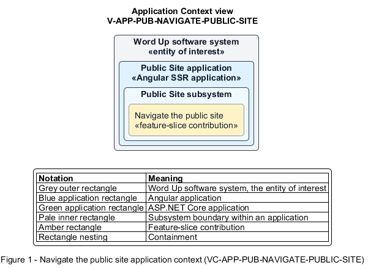

# Navigate the public site

## Identification and scope

The Word Up software system is the entity of interest (EoI). The Navigate the public site feature slice (`FS-PUB-NAVIGATE-PUBLIC-SITE`) is an architecture description element in the Public Site subsystem.

| Item | Identification |
| --- | --- |
| Participating applications | Public Site application |
| Architecture view | Application Context view (`V-APP-PUB-NAVIGATE-PUBLIC-SITE`) |
| Governing viewpoint | Application Context viewpoint (`VP-APP-CONTEXT`) |
| View component | Nested Application Context component (`VC-APP-PUB-NAVIGATE-PUBLIC-SITE`) |

This focused description addresses feature scope, behavior, application context, and requirement correspondences. It does not claim conformance as a complete architecture description.

## Overview

The Navigate the public site feature slice allows an anonymous visitor reach safe marketing content and the platform's primary next actions.

## Application context

The Application Context view (`V-APP-PUB-NAVIGATE-PUBLIC-SITE`) applies the Application Context viewpoint (`VP-APP-CONTEXT`) to the Word Up software system. The viewpoint frames the application-location concern (`C-APP-LOCATION`). The view component (`VC-APP-PUB-NAVIGATE-PUBLIC-SITE`) uses the nested-containment model kind.

Nested rectangles identify the EoI, each participating application, the subsystem boundary, and the feature-slice contribution. Figure 1 presents the view component.

*Figure 1 — Application Context view: the Navigate the public site feature slice within the participating Word Up applications.*

## Behavior

- **Entry.** A visitor requests any public route on any supported viewport.
- **Processing.** The route responds without authentication, renders no unpublished personal data, reflows responsively with accessible tap targets, and exposes working Apply, Sign in, Get involved, and Contact calls to action.
- **Result.** The visitor can explore or continue to a clear public or authentication journey.

## Scope boundary

The specific content and form submissions behind those destinations are separate slices.

## Correspondences

The requirement-trace correspondence method (`M-REQ-TRACE`) relates stable L2 requirement identifiers to feature slices. The Navigate the public site requirement correspondence (`COR-REQ-PUB-NAVIGATE-PUBLIC-SITE`) records the following relationships.

| Requirement | Relationship |
| --- | --- |
| `L2-PUB-001` | Primary requirement |
| `L2-NFR-009` | Dependency |
| `L2-NFR-010` | Dependency |
