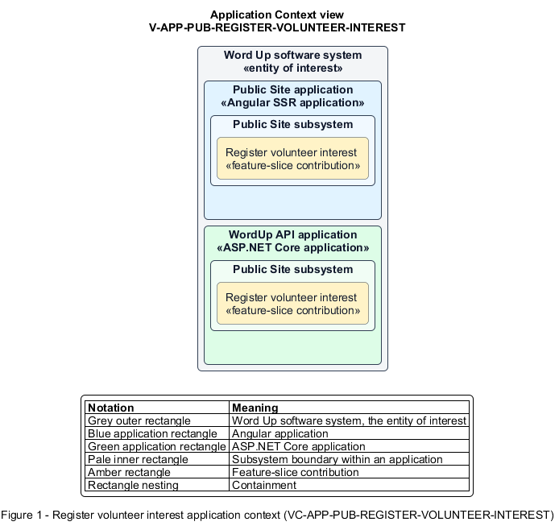

# Register volunteer interest

## Identification and scope

The Word Up software system is the entity of interest (EoI). The Register volunteer interest feature slice (`FS-PUB-REGISTER-VOLUNTEER-INTEREST`) is an architecture description element in the Public Site subsystem.

| Item | Identification |
| --- | --- |
| Participating applications | Public Site application; WordUp API application |
| Architecture view | Application Context view (`V-APP-PUB-REGISTER-VOLUNTEER-INTEREST`) |
| Governing viewpoint | Application Context viewpoint (`VP-APP-CONTEXT`) |
| View component | Nested Application Context component (`VC-APP-PUB-REGISTER-VOLUNTEER-INTEREST`) |

This focused description addresses feature scope, behavior, application context, and requirement correspondences. It does not claim conformance as a complete architecture description.

## Overview

The Register volunteer interest feature slice allows a visitor express interest in volunteering while acknowledging youth-safeguarding screening.

## Application context

The Application Context view (`V-APP-PUB-REGISTER-VOLUNTEER-INTEREST`) applies the Application Context viewpoint (`VP-APP-CONTEXT`) to the Word Up software system. The viewpoint frames the application-location concern (`C-APP-LOCATION`). The view component (`VC-APP-PUB-REGISTER-VOLUNTEER-INTEREST`) uses the nested-containment model kind.

Nested rectangles identify the EoI, each participating application, the subsystem boundary, and the feature-slice contribution. Figure 1 presents the view component.

*Figure 1 — Application Context view: the Register volunteer interest feature slice within the participating Word Up applications.*

## Behavior

- **Entry.** A visitor completes the Get involved volunteer form.
- **Processing.** The API validates and sanitizes contact and interest fields and blocks submission until the visitor acknowledges required screening and reference checks.
- **Result.** The API stores a volunteer-interest record, and the visitor receives acknowledgement of next steps.

## Scope boundary

Account invitation, screening operations, and the authenticated Volunteer Portal are outside this slice.

## Correspondences

The requirement-trace correspondence method (`M-REQ-TRACE`) relates stable L2 requirement identifiers to feature slices. The Register volunteer interest requirement correspondence (`COR-REQ-PUB-REGISTER-VOLUNTEER-INTEREST`) records the following relationships.

| Requirement | Relationship |
| --- | --- |
| `L2-PUB-003` | Primary requirement |
| `L2-NFR-001` | Dependency |
| `L2-CONSENT-004` | Dependency |
