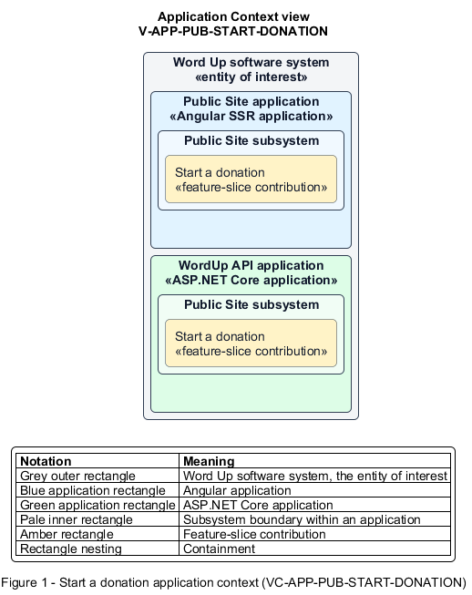

# Start a donation

## Identification and scope

The Word Up software system is the entity of interest (EoI). The Start a donation feature slice (`FS-PUB-START-DONATION`) is an architecture description element in the Public Site subsystem.

| Item | Identification |
| --- | --- |
| Participating applications | Public Site application; WordUp API application |
| Architecture view | Application Context view (`V-APP-PUB-START-DONATION`) |
| Governing viewpoint | Application Context viewpoint (`VP-APP-CONTEXT`) |
| View component | Nested Application Context component (`VC-APP-PUB-START-DONATION`) |

This focused description addresses feature scope, behavior, application context, and requirement correspondences. It does not claim conformance as a complete architecture description.

## Overview

The Start a donation feature slice allows a visitor choose a donation option and hand payment safely to an external provider.

## Application context

The Application Context view (`V-APP-PUB-START-DONATION`) applies the Application Context viewpoint (`VP-APP-CONTEXT`) to the Word Up software system. The viewpoint frames the application-location concern (`C-APP-LOCATION`). The view component (`VC-APP-PUB-START-DONATION`) uses the nested-containment model kind.

Nested rectangles identify the EoI, each participating application, the subsystem boundary, and the feature-slice contribution. Figure 1 presents the view component.

*Figure 1 — Application Context view: the Start a donation feature slice within the participating Word Up applications.*

## Behavior

- **Entry.** A visitor selects a configured donation tier, including recurring monthly where enabled, and confirms.
- **Processing.** The platform creates only the non-card donation request context, redirects or hands off to a PCI-compliant provider, stores no card data, and handles the provider acknowledgement result.
- **Result.** The visitor sees a clear acknowledgement without payment credentials entering Word Up systems.

## Scope boundary

Card capture, settlement, and PCI processing remain entirely with the external provider.

## Correspondences

The requirement-trace correspondence method (`M-REQ-TRACE`) relates stable L2 requirement identifiers to feature slices. The Start a donation requirement correspondence (`COR-REQ-PUB-START-DONATION`) records the following relationships.

| Requirement | Relationship |
| --- | --- |
| `L2-PUB-003` | Primary requirement |
