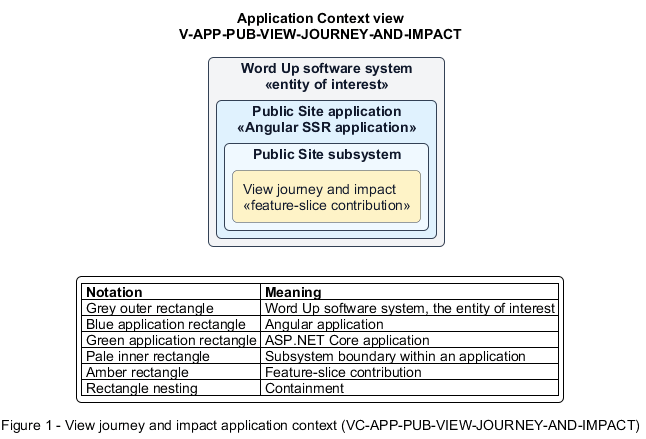

# View journey and impact

## Identification and scope

The Word Up software system is the entity of interest (EoI). The View journey and impact feature slice (`FS-PUB-VIEW-JOURNEY-AND-IMPACT`) is an architecture description element in the Public Site subsystem.

| Item | Identification |
| --- | --- |
| Participating applications | Public Site application |
| Architecture view | Application Context view (`V-APP-PUB-VIEW-JOURNEY-AND-IMPACT`) |
| Governing viewpoint | Application Context viewpoint (`VP-APP-CONTEXT`) |
| View component | Nested Application Context component (`VC-APP-PUB-VIEW-JOURNEY-AND-IMPACT`) |

This focused description addresses feature scope, behavior, application context, and requirement correspondences. It does not claim conformance as a complete architecture description.

## Overview

The View journey and impact feature slice explains how a participant moves through Word Up and what the program has achieved.

## Application context

The Application Context view (`V-APP-PUB-VIEW-JOURNEY-AND-IMPACT`) applies the Application Context viewpoint (`VP-APP-CONTEXT`) to the Word Up software system. The viewpoint frames the application-location concern (`C-APP-LOCATION`). The view component (`VC-APP-PUB-VIEW-JOURNEY-AND-IMPACT`) uses the nested-containment model kind.

Nested rectangles identify the EoI, each participating application, the subsystem boundary, and the feature-slice contribution. Figure 1 presents the view component.

*Figure 1 — Application Context view: the View journey and impact feature slice within the participating Word Up applications.*

## Behavior

- **Entry.** An anonymous visitor opens the landing or about content.
- **Processing.** The page presents the four-step journey—Apply, join a cohort, learn modules, lead and graduate—and displays approved impact statistics from publishable data.
- **Result.** The visitor understands both the expected path and the program's evidence of impact.

## Scope boundary

Individual progress and internal reporting data are never exposed through this slice.

## Correspondences

The requirement-trace correspondence method (`M-REQ-TRACE`) relates stable L2 requirement identifiers to feature slices. The View journey and impact requirement correspondence (`COR-REQ-PUB-VIEW-JOURNEY-AND-IMPACT`) records the following relationships.

| Requirement | Relationship |
| --- | --- |
| `L2-PUB-002` | Primary requirement |
| `L2-AUTH-010` | Dependency |
