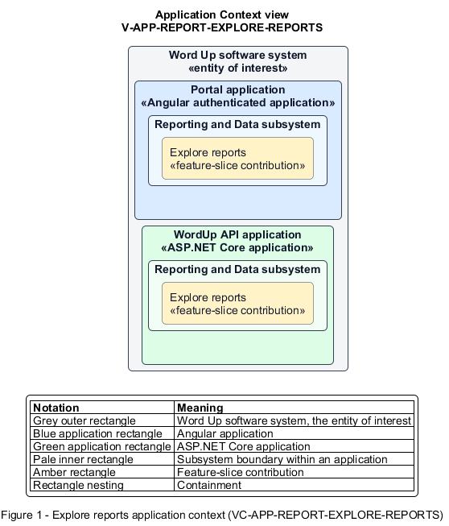

# Explore reports

## Identification and scope

The Word Up software system is the entity of interest (EoI). The Explore reports feature slice (`FS-REPORT-EXPLORE-REPORTS`) is an architecture description element in the Reporting and Data subsystem.

| Item | Identification |
| --- | --- |
| Participating applications | Portal application; WordUp API application |
| Architecture view | Application Context view (`V-APP-REPORT-EXPLORE-REPORTS`) |
| Governing viewpoint | Application Context viewpoint (`VP-APP-CONTEXT`) |
| View component | Nested Application Context component (`VC-APP-REPORT-EXPLORE-REPORTS`) |

This focused description addresses feature scope, behavior, application context, and requirement correspondences. It does not claim conformance as a complete architecture description.

## Overview

The Explore reports feature slice provides authorized staff a scoped reporting hub with shared filters and trustworthy freshness context.

## Application context

The Application Context view (`V-APP-REPORT-EXPLORE-REPORTS`) applies the Application Context viewpoint (`VP-APP-CONTEXT`) to the Word Up software system. The viewpoint frames the application-location concern (`C-APP-LOCATION`). The view component (`VC-APP-REPORT-EXPLORE-REPORTS`) uses the nested-containment model kind.

Nested rectangles identify the EoI, each participating application, the subsystem boundary, and the feature-slice contribution. Figure 1 presents the view component.

*Figure 1 — Application Context view: the Explore reports feature slice within the participating Word Up applications.*

## Behavior

- **Entry.** A staff member opens Reports and sets date range, cohort, track, or mentor filters.
- **Processing.** The server applies role scope and recomputes headline KPIs and chart data for the selected filters, returning record count and update timestamp plus empty or retryable error states.
- **Result.** The user can understand the selected population and continue to a detailed standard report.

## Scope boundary

Each detailed report and file export has its own slice.

## Correspondences

The requirement-trace correspondence method (`M-REQ-TRACE`) relates stable L2 requirement identifiers to feature slices. The Explore reports requirement correspondence (`COR-REQ-REPORT-EXPLORE-REPORTS`) records the following relationships.

| Requirement | Relationship |
| --- | --- |
| `L2-REPORT-001` | Primary requirement |
| `L2-AUTH-010` | Dependency |
| `L2-NFR-008` | Dependency |
