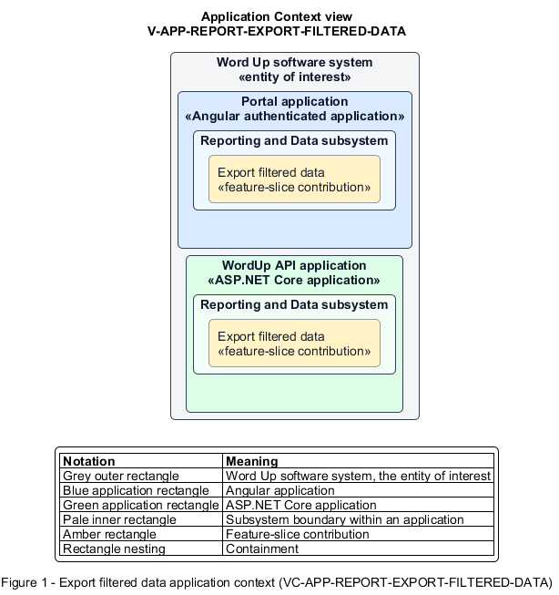

# Export filtered data

## Identification and scope

The Word Up software system is the entity of interest (EoI). The Export filtered data feature slice (`FS-REPORT-EXPORT-FILTERED-DATA`) is an architecture description element in the Reporting and Data subsystem.

| Item | Identification |
| --- | --- |
| Participating applications | Portal application; WordUp API application |
| Architecture view | Application Context view (`V-APP-REPORT-EXPORT-FILTERED-DATA`) |
| Governing viewpoint | Application Context viewpoint (`VP-APP-CONTEXT`) |
| View component | Nested Application Context component (`VC-APP-REPORT-EXPORT-FILTERED-DATA`) |

This focused description addresses feature scope, behavior, application context, and requirement correspondences. It does not claim conformance as a complete architecture description.

## Overview

The Export filtered data feature slice produces a portable CSV or PDF from the exact authorized data currently being viewed.

## Application context

The Application Context view (`V-APP-REPORT-EXPORT-FILTERED-DATA`) applies the Application Context viewpoint (`VP-APP-CONTEXT`) to the Word Up software system. The viewpoint frames the application-location concern (`C-APP-LOCATION`). The view component (`VC-APP-REPORT-EXPORT-FILTERED-DATA`) uses the nested-containment model kind.

Nested rectangles identify the EoI, each participating application, the subsystem boundary, and the feature-slice contribution. Figure 1 presents the view component.

*Figure 1 — Application Context view: the Export filtered data feature slice within the participating Word Up applications.*

## Behavior

- **Entry.** An authorized user requests export from a report, progress board, attendance view, or audit log and chooses a format.
- **Processing.** The server reapplies current filters and role scope, emits raw rows for CSV or a formatted summary for PDF, restricts audit exports to administrators, and audit-logs the export itself.
- **Result.** The downloaded artifact matches the visible scope and contains no unauthorized records or fields.

## Scope boundary

The source view owns calculations; this slice owns secure rendering of the export artifact.

## Correspondences

The requirement-trace correspondence method (`M-REQ-TRACE`) relates stable L2 requirement identifiers to feature slices. The Export filtered data requirement correspondence (`COR-REQ-REPORT-EXPORT-FILTERED-DATA`) records the following relationships.

| Requirement | Relationship |
| --- | --- |
| `L2-REPORT-003` | Primary requirement |
| `L2-AUTH-010` | Dependency |
| `L2-CONSENT-003` | Dependency |
