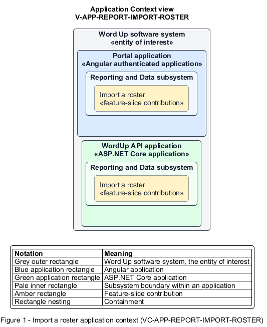

# Import a roster

## Identification and scope

The Word Up software system is the entity of interest (EoI). The Import a roster feature slice (`FS-REPORT-IMPORT-ROSTER`) is an architecture description element in the Reporting and Data subsystem.

| Item | Identification |
| --- | --- |
| Participating applications | Portal application; WordUp API application |
| Architecture view | Application Context view (`V-APP-REPORT-IMPORT-ROSTER`) |
| Governing viewpoint | Application Context viewpoint (`VP-APP-CONTEXT`) |
| View component | Nested Application Context component (`VC-APP-REPORT-IMPORT-ROSTER`) |

This focused description addresses feature scope, behavior, application context, and requirement correspondences. It does not claim conformance as a complete architecture description.

## Overview

The Import a roster feature slice allows administrators safely migrate valid people from a CSV without duplicating accounts.

## Application context

The Application Context view (`V-APP-REPORT-IMPORT-ROSTER`) applies the Application Context viewpoint (`VP-APP-CONTEXT`) to the Word Up software system. The viewpoint frames the application-location concern (`C-APP-LOCATION`). The view component (`VC-APP-REPORT-IMPORT-ROSTER`) uses the nested-containment model kind.

Nested rectangles identify the EoI, each participating application, the subsystem boundary, and the feature-slice contribution. Figure 1 presents the view component.

*Figure 1 — Application Context view: the Import a roster feature slice within the participating Word Up applications.*

## Behavior

- **Entry.** An administrator uploads a size-limited `.csv`, maps source columns, and reviews the preview.
- **Processing.** The wizard reports dimensions, supports mapped or skipped columns, and classifies each row as Ready, Missing Consent, or Duplicate. On confirmation, the API imports only Ready rows idempotently by email and audits the result.
- **Result.** The import service creates or updates valid people once, keeps excluded rows visible for follow-up, and reports the imported count.

## Scope boundary

Invitation delivery and later cohort or consent management are separate slices.

## Correspondences

The requirement-trace correspondence method (`M-REQ-TRACE`) relates stable L2 requirement identifiers to feature slices. The Import a roster requirement correspondence (`COR-REQ-REPORT-IMPORT-ROSTER`) records the following relationships.

| Requirement | Relationship |
| --- | --- |
| `L2-REPORT-004` | Primary requirement |
| `L2-NFR-001` | Dependency |
| `L2-CONSENT-003` | Dependency |
