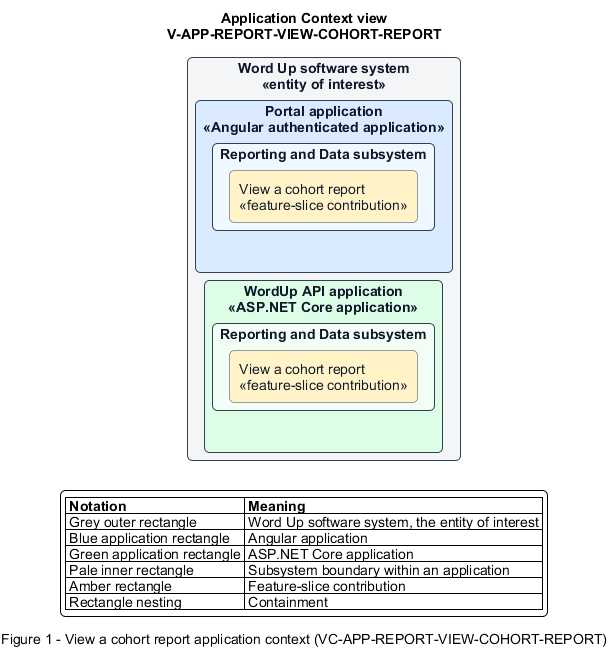

# View a cohort report

## Identification and scope

The Word Up software system is the entity of interest (EoI). The View a cohort report feature slice (`FS-REPORT-VIEW-COHORT-REPORT`) is an architecture description element in the Reporting and Data subsystem.

| Item | Identification |
| --- | --- |
| Participating applications | Portal application; WordUp API application |
| Architecture view | Application Context view (`V-APP-REPORT-VIEW-COHORT-REPORT`) |
| Governing viewpoint | Application Context viewpoint (`VP-APP-CONTEXT`) |
| View component | Nested Application Context component (`VC-APP-REPORT-VIEW-COHORT-REPORT`) |

This focused description addresses feature scope, behavior, application context, and requirement correspondences. It does not claim conformance as a complete architecture description.

## Overview

The View a cohort report feature slice allows authorized staff evaluate one cohort and compare it with a meaningful benchmark.

## Application context

The Application Context view (`V-APP-REPORT-VIEW-COHORT-REPORT`) applies the Application Context viewpoint (`VP-APP-CONTEXT`) to the Word Up software system. The viewpoint frames the application-location concern (`C-APP-LOCATION`). The view component (`VC-APP-REPORT-VIEW-COHORT-REPORT`) uses the nested-containment model kind.

Nested rectangles identify the EoI, each participating application, the subsystem boundary, and the feature-slice contribution. Figure 1 presents the view component.

*Figure 1 — Application Context view: the View a cohort report feature slice within the participating Word Up applications.*

## Behavior

- **Entry.** A user selects a cohort plus current filters and an optional comparison target.
- **Processing.** The server aggregates enrollment, completion, attendance, retention, module progress, and youth status counts and can compare program average, another cohort, or a previous term within authorization scope.
- **Result.** Staff can identify cohort-level strengths, gaps, and changes over time.

## Scope boundary

The operational progress matrix and attendance capture are separate features.

## Correspondences

The requirement-trace correspondence method (`M-REQ-TRACE`) relates stable L2 requirement identifiers to feature slices. The View a cohort report requirement correspondence (`COR-REQ-REPORT-VIEW-COHORT-REPORT`) records the following relationships.

| Requirement | Relationship |
| --- | --- |
| `L2-REPORT-001` | Primary requirement |
| `L2-AUTH-010` | Dependency |
