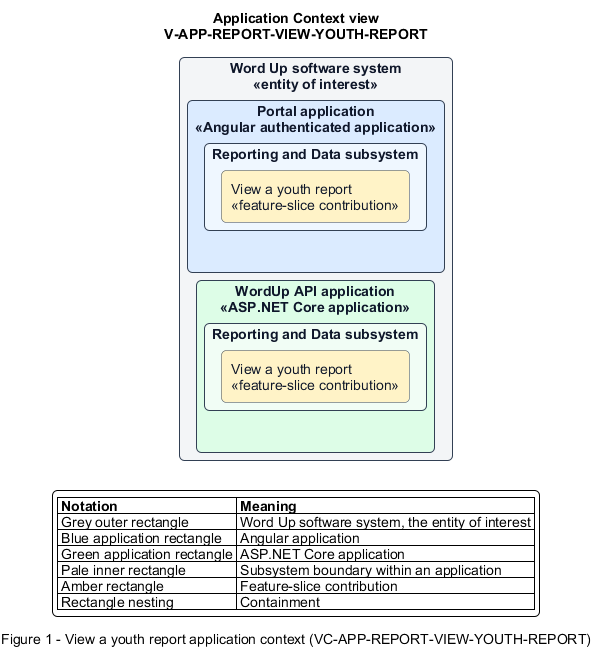

# View a youth report

## Identification and scope

The Word Up software system is the entity of interest (EoI). The View a youth report feature slice (`FS-REPORT-VIEW-YOUTH-REPORT`) is an architecture description element in the Reporting and Data subsystem.

| Item | Identification |
| --- | --- |
| Participating applications | Portal application; WordUp API application |
| Architecture view | Application Context view (`V-APP-REPORT-VIEW-YOUTH-REPORT`) |
| Governing viewpoint | Application Context viewpoint (`VP-APP-CONTEXT`) |
| View component | Nested Application Context component (`VC-APP-REPORT-VIEW-YOUTH-REPORT`) |

This focused description addresses feature scope, behavior, application context, and requirement correspondences. It does not claim conformance as a complete architecture description.

## Overview

The View a youth report feature slice composes one authorized youth's learning and participation evidence into a standard report.

## Application context

The Application Context view (`V-APP-REPORT-VIEW-YOUTH-REPORT`) applies the Application Context viewpoint (`VP-APP-CONTEXT`) to the Word Up software system. The viewpoint frames the application-location concern (`C-APP-LOCATION`). The view component (`VC-APP-REPORT-VIEW-YOUTH-REPORT`) uses the nested-containment model kind.

Nested rectangles identify the EoI, each participating application, the subsystem boundary, and the feature-slice contribution. Figure 1 presents the view component.

*Figure 1 — Application Context view: the View a youth report feature slice within the participating Word Up applications.*

## Behavior

- **Entry.** An authorized staff member selects a youth from the report context.
- **Processing.** The report combines progress rings, module completion, quiz scores, attendance, latest competencies, permitted mentor-note summary, and badges while enforcing assignment scope.
- **Result.** The viewer receives one coherent, current picture of the youth's program outcomes.

## Scope boundary

Private check-in contents and data outside the requester's assigned scope remain excluded.

## Correspondences

The requirement-trace correspondence method (`M-REQ-TRACE`) relates stable L2 requirement identifiers to feature slices. The View a youth report requirement correspondence (`COR-REQ-REPORT-VIEW-YOUTH-REPORT`) records the following relationships.

| Requirement | Relationship |
| --- | --- |
| `L2-REPORT-001` | Primary requirement |
| `L2-AUTH-010` | Dependency |
| `L2-MENTOR-006` | Dependency |
