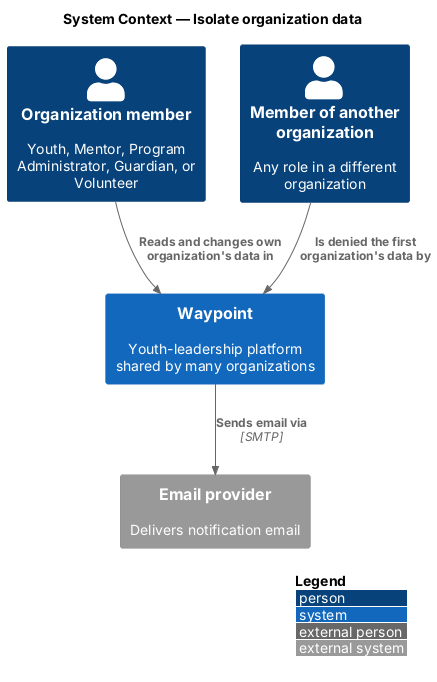
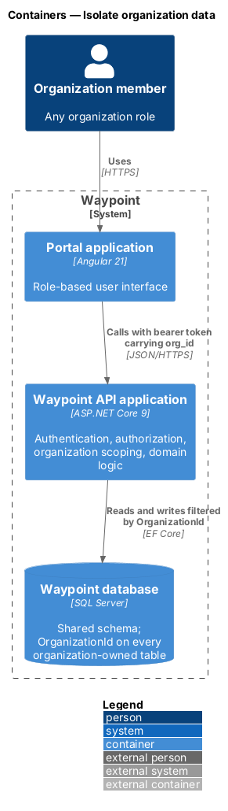
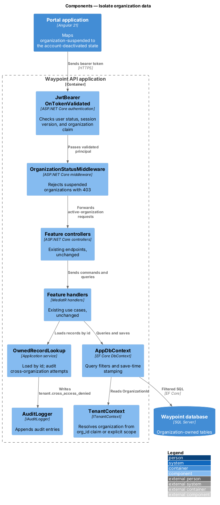
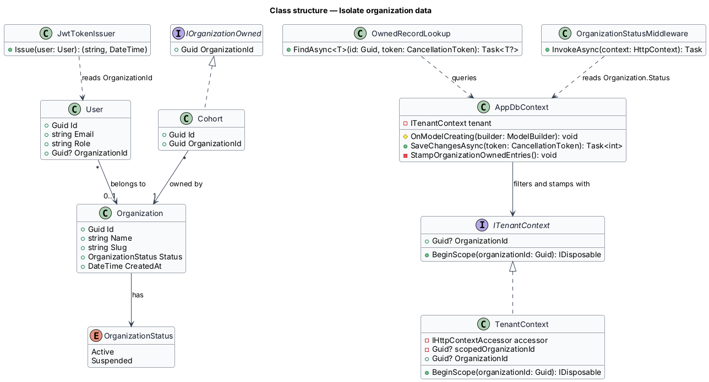
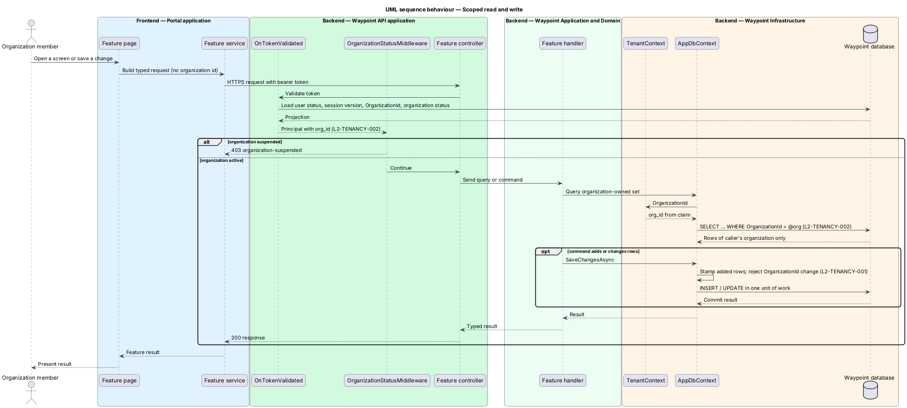
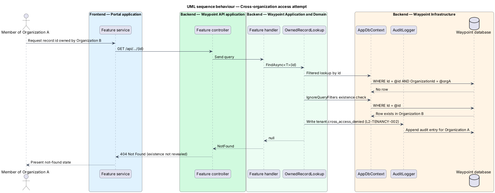

# Isolate organization data

## Overview

Waypoint is a youth-leadership software system for program intake, learning, mentoring, safeguarding, and program operations. The Multi-Tenancy subsystem lets one deployment and one SQL Server database serve many organizations while keeping each organization's records separate.

This feature slice is the isolation core that every other tenancy slice depends on. It gives each organization-owned record an owning organization. It resolves the caller's organization from the signed-in session. It applies that organization to every read and every write that the Waypoint API performs.

- **organization** — tenant of the Waypoint deployment that runs one youth program and owns its people and program data
- **organization-owned record** — persisted row that belongs to exactly one organization, such as a cohort, a submission, or a message
- **platform-level record** — persisted row that belongs to no organization, such as an organization itself or public-site content
- **tenant context** — per-request or per-job value that holds the organization identifier the current work runs under
- **query filter** — EF Core model rule appended to every query for an entity type

Role scoping (`L2-AUTH-009`, `L2-AUTH-010`) continues to decide what a role may see inside one organization. This slice adds the outer boundary: no role sees outside its own organization. Background work, organization provisioning, suspension, and the data migration are adjacent slices.

## Description

### Vertical slice boundary

The slice lives almost entirely in the Waypoint API application. The Portal application gains one mapping for the suspended-organization response and otherwise changes nothing. Isolation does not depend on any frontend check.

### Components and types

A source link identifies an existing type that this slice changes. An unlinked name identifies a type that this slice introduces.

| Layer | Components, types, and classes | Responsibility |
| --- | --- | --- |
| Domain | `Organization` `OrganizationStatus` | Holds `Id`, `Name`, `Slug`, `Status`, and `CreatedAt`. `OrganizationStatus` has the values `Active` and `Suspended`. |
| Domain | `IOrganizationOwned` | Marks an entity as organization-owned through a `Guid OrganizationId` property. Each organization-owned entity in [`AppDbContext`](../../../../backend/src/Waypoint.Infrastructure/AppDbContext.cs) implements it. |
| Domain | [`User`](../../../../backend/src/Waypoint.Domain/Authentication/User.cs) | Gains `Guid? OrganizationId`. The value is null only for the Platform Operator role. A database check constraint enforces that rule. |
| Application port | `ITenantContext` | Exposes `Guid? OrganizationId` and `BeginScope(Guid organizationId)`. Handlers and the persistence layer read the organization only through this port. |
| Application port | [`ICurrentUser`](../../../../backend/src/Waypoint.Application/Shared/Abstractions/ICurrentUser.cs) | Unchanged. Identity stays separate from tenancy. |
| Application shared | `OwnedRecordLookup` | Loads an organization-owned record by id. On a miss, it checks without the query filter whether the id exists in another organization. If it does, it writes a `tenant.cross_access_denied` audit entry. It always returns not found to the caller. |
| Infrastructure | `TenancyOptions` | Holds `PublicSubmissionOrganizationId`, the organization that receives anonymous public-site submissions. |
| Infrastructure | `TenantContext` | Scoped implementation of `ITenantContext`. It reads the `org_id` claim from the authenticated principal. An explicit scope from `BeginScope` takes precedence for the lifetime of the scope. |
| Infrastructure | [`JwtTokenIssuer`](../../../../backend/src/Waypoint.Infrastructure/JwtTokenIssuer.cs) | Adds the `org_id` claim from `User.OrganizationId` to each access token. |
| Infrastructure | [`AppDbContext`](../../../../backend/src/Waypoint.Infrastructure/AppDbContext.cs) | Registers a query filter `OrganizationId == tenant.OrganizationId` on every `IOrganizationOwned` entity and on `User`. Before each save, it stamps added entries with the tenant organization and rejects any change to an existing `OrganizationId`. |
| API | [`Program`](../../../../backend/src/Waypoint.Api/Program.cs) `OnTokenValidated` | Extends the existing per-request user projection with the user's `OrganizationId` and the organization's `Status`. It fails the request when the claim and the stored organization differ. |
| API | `OrganizationStatusMiddleware` | Returns `403` ProblemDetails with type `organization-suspended` when the caller's organization is suspended. |
| Frontend | [`api-state.interceptor.ts`](../../../../frontend/projects/core/src/lib/api-state.interceptor.ts) | Maps the `organization-suspended` problem type to the existing account-deactivated state (`L1-PLATFORM-003`). |

### Functions and data flow

- `JwtTokenIssuer.Issue(user)` writes `org_id` beside the existing `sub`, `role`, and `session_version` claims.
- `TenantContext.OrganizationId` returns the scoped value when a scope is open, otherwise the `org_id` claim, otherwise null.
- `AppDbContext.OnModelCreating` loops over entity types assignable to `IOrganizationOwned` and calls `HasQueryFilter`. EF Core evaluates the filter's context member per query, so one compiled model serves every organization.
- A null tenant organization matches no organization-owned row. Unauthenticated and Platform Operator requests therefore read no organization data.
- `AppDbContext.SaveChangesAsync` sets `OrganizationId` on each `Added` `IOrganizationOwned` entry from the tenant context. It throws when an added entry has no tenant organization or a `Modified` entry changes `OrganizationId`. Any client-supplied organization value is overwritten or rejected.
- Anonymous entry points run without an `org_id` claim, so they resolve the organization from the record they start from:
  - Sign-in and the password-reset request look up `User` by email with `IgnoreQueryFilters()`, because sign-in emails stay unique platform-wide.
  - Refresh-token rotation, invitation acceptance (`InvitationsController`), password-reset completion (`PasswordResetController`), and the guardian consent response (`ConsentController`) look up their single-use token with `IgnoreQueryFilters()`.
  - Each of these flows then calls `ITenantContext.BeginScope` with the found record's `OrganizationId` before any further read or write.
- Public-site submissions (`PublicController`, the anonymous application endpoint in `ApplicationsController`) have no source record to resolve from. They stamp `TenancyOptions.PublicSubmissionOrganizationId`, a deployment setting that points at the default organization. The final routing rule is the open product decision A-11 in `docs/specs/README.md`: `<TO SUPPLY>`.
- No other API call site shall call `IgnoreQueryFilters()`. Background processors follow their own rule in [scope-background-work](../scope-background-work/README.md).
- Search, autocomplete, and uniqueness checks run through the filtered sets, so they consider only the caller's organization.
- Each unique index on an organization-owned table becomes a composite index that leads with `OrganizationId`. The `User.Email` unique index stays platform-wide.
- Each lookup index on an organization-owned table leads with `OrganizationId` (`L2-TENANCY-008`). The performance suite runs against a seed of 50 organizations to confirm p95 budgets.

### Behavior

1. **Sign-in.** The user signs in. The access token carries `org_id`.
2. **Request.** `OnTokenValidated` confirms that the user is active and the stored organization matches the claim. `OrganizationStatusMiddleware` rejects a suspended organization with `403`.
3. **Read.** Handlers query `IAppDbContext`. The query filter limits every result to the caller's organization.
4. **Lookup by id.** A record in another organization is invisible. `OwnedRecordLookup` writes the audit entry, and the endpoint returns `404`.
5. **Write.** `SaveChangesAsync` stamps new rows and rejects any change of ownership.

## Requirements

| L2 ID | Refines (L1) | Requirement |
|-------|--------------|-------------|
| `L2-TENANCY-001` | `L1-TENANCY-001` | Every organization-owned record shall carry a required, immutable organization identifier, and each user account shall belong to exactly one organization; public-site content and Platform Operator accounts are platform-level and belong to no organization. |
| `L2-TENANCY-002` | `L1-TENANCY-001` | The server shall resolve the caller's organization from their authenticated session, never from a header, query string, route, or body, and shall apply it to every read and write of organization-owned data, in addition to role scoping. |
| `L2-TENANCY-008` | `L1-TENANCY-001` | Adding organization scoping shall not measurably slow the product. |

## Diagrams

### C4 system context

Figure 1 shows that every Waypoint role reaches organization data only through the Waypoint software system, which enforces the organization boundary.

*Figure 1 — C4 system context: Isolate organization data.*

### C4 container

Figure 2 places the boundary in the Waypoint API and the Waypoint database. The Portal application holds no isolation logic.

*Figure 2 — C4 container view: Isolate organization data.*

### C4 component

Figure 3 shows the components inside the Waypoint API that resolve, apply, and audit the organization boundary.

*Figure 3 — C4 component view: Isolate organization data.*

### Class structure

Figure 4 shows the new domain types, the tenant port and its implementation, and the persistence context that applies them.

*Figure 4 — Class structure: Isolate organization data.*

### Sequence: scoped read and write

Figure 5 traces an authenticated request from token validation through a filtered read and a stamped write.

*Figure 5 — Sequence behaviour: scoped read and write.*

### Sequence: cross-organization access attempt

Figure 6 traces a request for a record id that belongs to another organization. The caller receives `404`, and the attempt is audited.

*Figure 6 — Sequence behaviour: cross-organization access attempt.*
