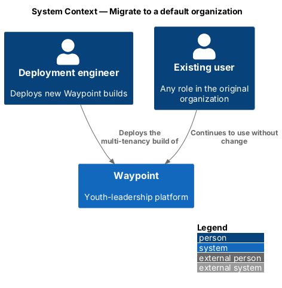
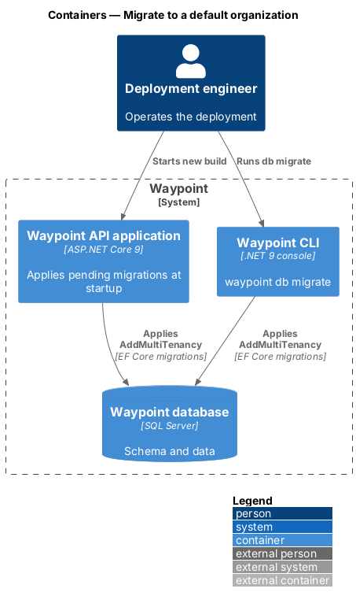
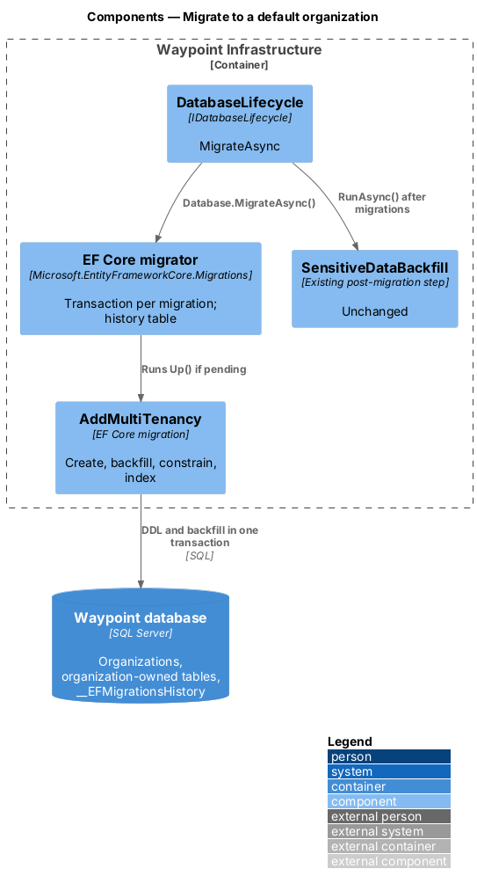
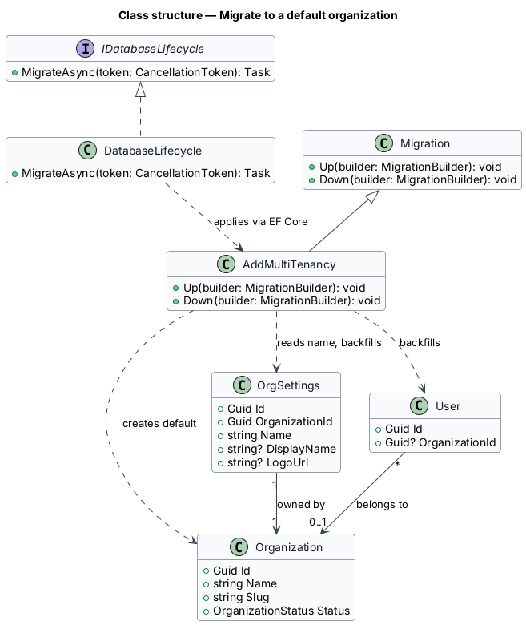
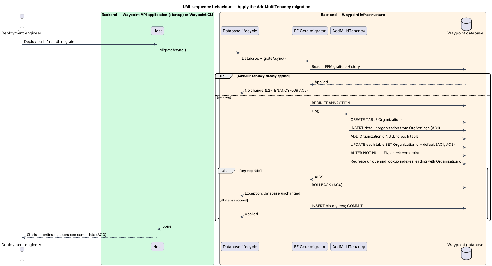

# Migrate to a default organization

## Overview

Waypoint is a youth-leadership software system for program intake, learning, mentoring, safeguarding, and program operations. The Multi-Tenancy subsystem lets one deployment serve many organizations while keeping each organization's records separate.

Waypoint runs today as a single organization, and its database holds that organization's live records. This slice is the one-time schema and data change that introduces organizations. It assigns every existing record to one default organization. Existing users see no difference, and every later slice can assume that each row has an owner.

- **default organization** — organization that the migration creates to own all data that existed before multi-tenancy
- **backfill** — migration step that writes the default organization identifier into each existing row
- **migration history** — EF Core `__EFMigrationsHistory` table that records which migrations have been applied

## Description

### Vertical slice boundary

The slice is backend-only. It consists of one EF Core migration and the existing startup and CLI paths that apply migrations. It has no Portal or API endpoint changes.

### Components and types

| Layer | Components, types, and classes | Responsibility |
| --- | --- | --- |
| Infrastructure | `AddMultiTenancy` migration in [`Migrations`](../../../../backend/src/Waypoint.Infrastructure/Migrations/) | Creates `Organizations`, inserts the default organization, adds and backfills `OrganizationId` on every organization-owned table, then makes the columns required and adds keys and indexes. |
| Infrastructure | [`DatabaseLifecycle`](../../../../backend/src/Waypoint.Infrastructure/DatabaseLifecycle.cs) | Unchanged. `MigrateAsync` applies pending migrations at API startup and from `waypoint db migrate`. |
| Infrastructure | [`AppDbContextModelSnapshot`](../../../../backend/src/Waypoint.Infrastructure/Migrations/AppDbContextModelSnapshot.cs) | Regenerated by the EF Core tooling, never edited by hand. |
| Infrastructure | [`HmacAuditIntegrity`](../../../../backend/src/Waypoint.Infrastructure/HmacAuditIntegrity.cs) | Selects the canonical form by `AuditEntry.HashVersion`. Version 1 is the current form, which excludes `OrganizationId`. Version 2 adds `OrganizationId`. |
| Domain | [`OrgSettings`](../../../../backend/src/Waypoint.Domain/ProgramAdministration/OrgSettings.cs) | Becomes organization-owned, one row per organization. The default organization's name comes from its existing row. |

### Functions and data flow

The `AddMultiTenancy` migration's `Up` method runs these steps in order:

1. Create `Organizations` with `Id`, `Name`, `Slug` (unique), `Status`, and `CreatedAt`.
2. Insert the default organization with a fixed, well-known `Id`. Its `Name` is `COALESCE(DisplayName, Name)` of the existing `OrgSettings` row, or `Waypoint` when no row exists. Its `Slug` is `default`. The slug is stable and never shown to organization members, so it does not need to match the display name, and its `Status` is `Active`.
3. Add a nullable `OrganizationId` column to each organization-owned table and to `Users`. Add `AuditEntries.HashVersion` with default `1`.
4. Run `UPDATE ... SET OrganizationId = @default` on each table. On `Users`, the update covers every row, because no Platform Operator exists before this migration.
5. Alter each organization-owned `OrganizationId` column to `NOT NULL` and add a foreign key to `Organizations`. `Users.OrganizationId` stays nullable and gains the check constraint that ties null to the `PlatformOperator` role.
6. Drop and recreate each of the 23 existing unique indexes on organization-owned tables as a composite that leads with `OrganizationId`. The unique index on `Users.Email` stays platform-wide.
7. Add `OrganizationId`-leading lookup indexes required by `L2-TENANCY-008`.

Atomicity and repeatability come from EF Core on SQL Server:

- EF Core runs each migration inside one transaction. A failure at any step rolls the schema and data back to the pre-migration state (`L2-TENANCY-009` criterion 4).
- EF Core records the migration in the migration history only after it commits. A second run finds it applied and makes no change (criterion 5).
- `Down` reverses the steps for development use. Production rollback relies on the transaction and a pre-deployment backup.

Verification:

- An integration test seeds a pre-tenancy database at the previous migration, `20261016010738_AddDisplayPreferenceTheme`. It records row counts for every organization-owned table, applies `AddMultiTenancy`, and asserts identical counts with every row owned by the default organization (criteria 1 and 2).
- The same test signs in as a seeded user and compares the dashboard response with the pre-migration response (criterion 3).
- A fault-injection test makes step 5 fail and asserts that the schema and data match the pre-migration state.

Audit integrity:

- `AuditEntry` gains an `int HashVersion` column. The migration sets it to `1` on every existing row and does not recompute any existing hash, so the chain stays valid.
- `HmacAuditIntegrity.ComputeHash` adds `OrganizationId` to the canonical form when `HashVersion` is `2` or higher. `AuditLogger` writes every new entry with `HashVersion = 2`, so a later change to an entry's owning organization breaks verification.
- The hash chain stays one platform-wide sequence. `VerifyChain` reads entries with `IgnoreQueryFilters()` so that the organization filter does not leave gaps in the sequence.

### Behavior

1. **Deploy.** The new build starts. `DatabaseLifecycle.MigrateAsync` finds `AddMultiTenancy` pending.
2. **Migrate.** The migration runs in one transaction and commits.
3. **Use.** Existing users sign in. Their tokens now carry the default organization's `org_id`, and they see the same data as before.

## Requirements

| L2 ID | Refines (L1) | Requirement |
|-------|--------------|-------------|
| `L2-TENANCY-009` | `L1-TENANCY-003` | When multi-tenancy is deployed, all pre-existing data shall be assigned to one default organization, with slug `default`, whose display name and logo are taken from the current organization settings. |

## Diagrams

### C4 system context

Figure 1 shows the deployment engineer who triggers the migration and the existing users who continue unaffected.

*Figure 1 — C4 system context: Migrate to a default organization.*

### C4 container

Figure 2 shows the two paths that apply the migration, API startup and the Waypoint CLI, and the database that they change.

*Figure 2 — C4 container view: Migrate to a default organization.*

### C4 component

Figure 3 shows the lifecycle service, the EF Core migrator, and the `AddMultiTenancy` migration inside the infrastructure layer.

*Figure 3 — C4 component view: Migrate to a default organization.*

### Class structure

Figure 4 shows the migration, the lifecycle service that runs it, and the tables that it creates and changes.

*Figure 4 — Class structure: Migrate to a default organization.*

### Sequence: apply the migration

Figure 5 traces the migration steps inside one transaction, with the failure alternative and the no-op second run.

*Figure 5 — Sequence behaviour: apply the AddMultiTenancy migration.*
