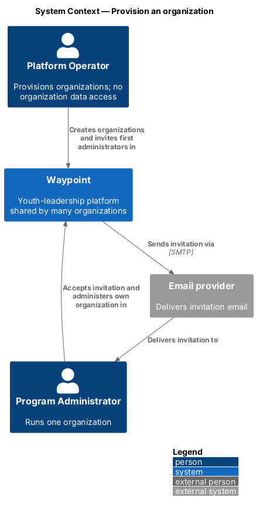
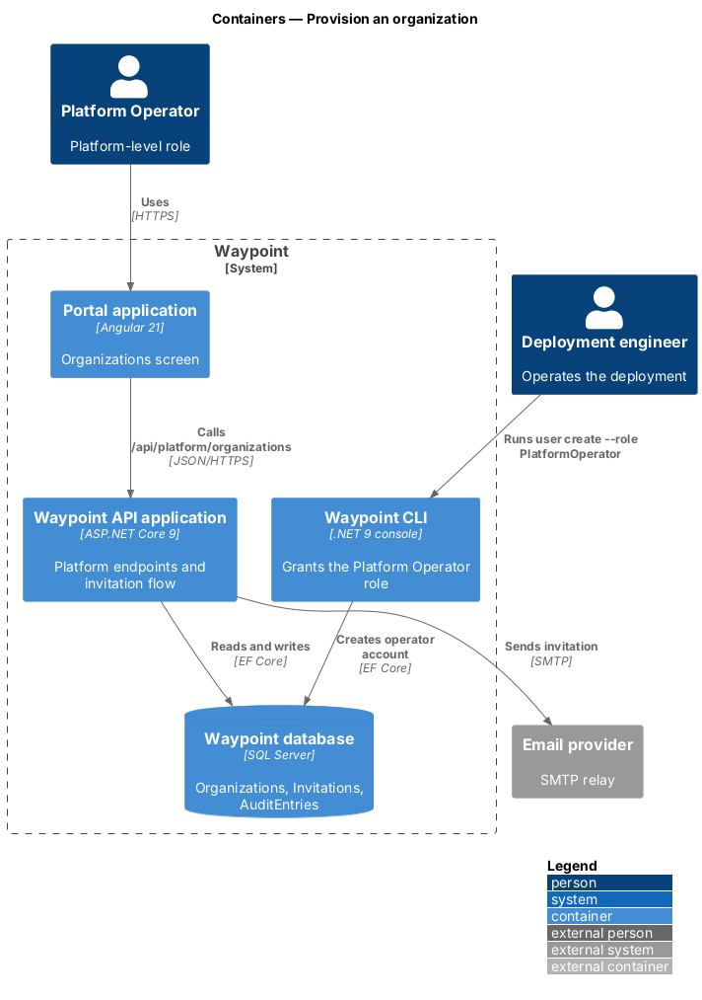
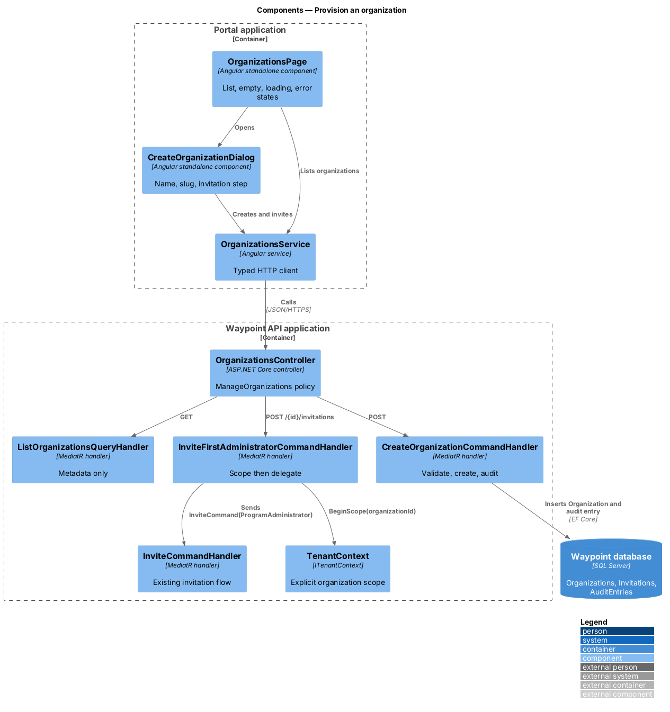
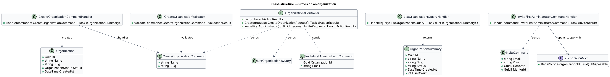
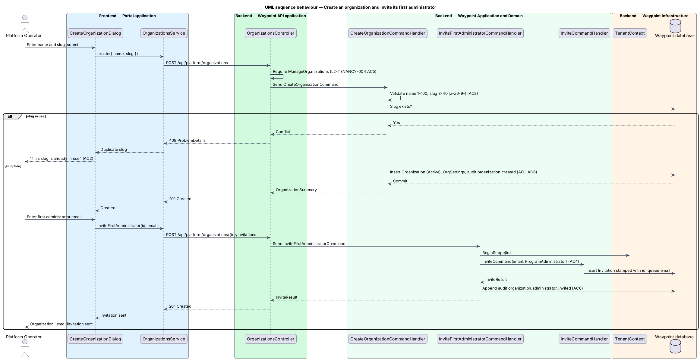

# Provision an organization

## Overview

Waypoint is a youth-leadership software system for program intake, learning, mentoring, safeguarding, and program operations. The Multi-Tenancy subsystem lets one deployment serve many organizations while keeping each organization's records separate.

This slice is how an organization comes into existence. A Platform Operator creates the organization and invites its first Program Administrator. That administrator then runs the organization with the existing administration screens. The Platform Operator sees only organization metadata and never sees youth, guardian, or program data.

- **Platform Operator** — platform-level role that creates, lists, suspends, and reactivates organizations and holds no organization membership
- **slug** — short, unique, URL-safe identifier of an organization, made of lowercase letters, digits, and hyphens
- **first administrator invitation** — invitation, issued by a Platform Operator, that makes the invitee a Program Administrator of one named organization

Suspension and reactivation are the adjacent [suspend-organization](../suspend-organization/README.md) slice. Data isolation itself is the [isolate-organization-data](../isolate-organization-data/README.md) slice.

## Description

### Vertical slice boundary

The slice spans the Portal application, the Waypoint API application, and the Waypoint CLI. The Portal application renders the Organizations screen and its create dialog. The API owns validation, authorization, persistence, and audit. The CLI is the only place that grants the Platform Operator role (`L2-TENANCY-006`).

### Components and types

| Layer | Components, types, and classes | Responsibility |
| --- | --- | --- |
| Frontend page | `OrganizationsPage` in `frontend/projects/admin/src/lib/organizations/` | Shows the organizations list. It renders a table at 768 px and wider and stacked cards below 576 px. It has loading, empty ("No organizations yet"), and error-with-retry states. |
| Frontend dialog | `CreateOrganizationDialog` | Collects display name and slug, shows inline field errors and the duplicate-slug message, then offers the first-administrator invitation step. It is built on the existing `dialog` component in `frontend/projects/components`. |
| Frontend API boundary | `OrganizationsService` in `frontend/projects/api/src/lib/services/organizations.service.ts` | Calls the platform endpoints with typed requests and responses. |
| Frontend routing | Route `platform/organizations` in [`app.routes.ts`](../../../../frontend/projects/portal/src/app/app.routes.ts) | Guarded by the existing `authGuard`. The server enforces the role; the client hides the route from other roles only for navigation. |
| API transport | `OrganizationsController` at `/api/platform/organizations` | Exposes `GET` (list), `POST` (create), and `POST /{id}/invitations` (invite the first administrator). Every action requires the `ManageOrganizations` policy. |
| API authorization | [`Policies`](../../../../backend/src/Waypoint.Api/Authorization/Policies.cs) | Gains `ManageOrganizations`, which requires the `PlatformOperator` role. Existing organization-data policies do not include `PlatformOperator`, so those endpoints return `403` to it. |
| Domain | [`Roles`](../../../../backend/src/Waypoint.Domain/Authentication/Roles.cs) | Gains `PlatformOperator`. `Roles.All`, which the in-app role pickers and invitations validate against, does not include it. |
| Application | `ListOrganizationsQuery` and handler | Returns name, slug, status, created date, and active user-account count for each organization, and no other field (`L2-TENANCY-006`). |
| Application | `CreateOrganizationCommand`, validator, and handler | Validates name (1–100 characters) and slug (3–40 characters, `^[a-z0-9-]+$`). It rejects a duplicate slug with the message "This slug is already in use". It creates the organization as `Active` and writes the audit entry. |
| Application | `InviteFirstAdministratorCommand` and handler | Opens `BeginScope(organizationId)` and sends the existing [`InviteCommand`](../../../../backend/src/Waypoint.Application/Authentication/Invitations/InviteCommand.cs) with role `ProgramAdministrator`. The invitation and the accepted user are therefore stamped with that organization. |
| Domain | `Organization` | Introduced by the isolation slice. Gains a unique index on `Slug`. |
| CLI | [`CliApplication`](../../../../backend/src/Waypoint.Cli/CliApplication.cs) `user create` | Accepts `--role PlatformOperator` and creates the account with a null `OrganizationId`. This is the deployment-time step that grants the role. |
| Audit | [`AuditEntry`](../../../../backend/src/Waypoint.Domain/ConsentAndSafeguarding/AuditEntry.cs) | Each platform action writes `organization.created` or `organization.administrator_invited`, with the operator as actor and the target organization as `OrganizationId`. The platform-level audit view lists entries whose action starts with `organization.` across all organizations. |

### Functions and data flow

- `CreateOrganizationCommandHandler.Handle` checks slug uniqueness and creates the `Organization` and its `OrgSettings` row with the display name. It writes the audit entry in the same unit of work.
- A unique index on `Organization.Slug` guards against a race between two concurrent creates. The handler maps the unique-key violation to the same duplicate-slug message.
- The handler returns `201` with the new organization summary. The dialog then moves to the invitation step.
- `InviteFirstAdministratorCommandHandler.Handle` confirms the organization exists and is `Active`, opens the organization scope, and delegates to the existing invitation flow. Email, expiry, resend, and revoke behave as in `L2-AUTH-003`.
- The Platform Operator's access token carries no `org_id` claim. Every organization-owned query it could reach returns no rows, and the policies return `403` first (`L2-TENANCY-006`).

### Behavior

1. **List.** The Platform Operator opens Organizations, and the page loads the metadata list.
2. **Create.** The operator submits a name and slug. The API validates, creates, and audits.
3. **Invite.** The operator enters the first administrator's email. The API issues an invitation scoped to the new organization.
4. **Accept.** The invitee accepts and becomes a Program Administrator of that organization only.

## Requirements

| L2 ID | Refines (L1) | Requirement |
|-------|--------------|-------------|
| `L2-TENANCY-004` | `L1-TENANCY-002` | A Platform Operator shall be able to create an organization by entering its display name and a unique URL-safe slug, and invite its first Program Administrator by email. |
| `L2-TENANCY-006` | `L1-TENANCY-002` | The Platform Operator role is platform-level; it shall see only organization metadata (name, slug, state, created date, number of user accounts) and shall not be able to read or change any organization-owned record. |
| `L2-TENANCY-007` | `L1-TENANCY-002` | The Platform Operator's Organizations screen shall follow the platform's responsive and accessibility rules. |

## Diagrams

### C4 system context

Figure 1 shows the Platform Operator beside the organization roles. The operator reaches organization metadata only.

*Figure 1 — C4 system context: Provision an organization.*

### C4 container

Figure 2 shows the Portal application, the Waypoint API application, and the Waypoint CLI that grants the Platform Operator role.

*Figure 2 — C4 container view: Provision an organization.*

### C4 component

Figure 3 shows the page, dialog, service, controller, and handlers that this slice introduces, and the existing invitation flow that it reuses.

*Figure 3 — C4 component view: Provision an organization.*

### Class structure

Figure 4 shows the commands, the query, and their handlers, and how the invitation handler reuses `InviteCommand` inside an organization scope.

*Figure 4 — Class structure: Provision an organization.*

### Sequence: create an organization and invite its first administrator

Figure 5 traces creation, including the duplicate-slug alternative, followed by the first administrator invitation.

*Figure 5 — Sequence behaviour: create an organization and invite its first administrator.*
