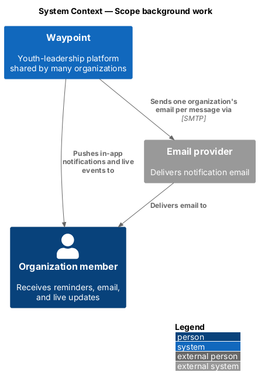
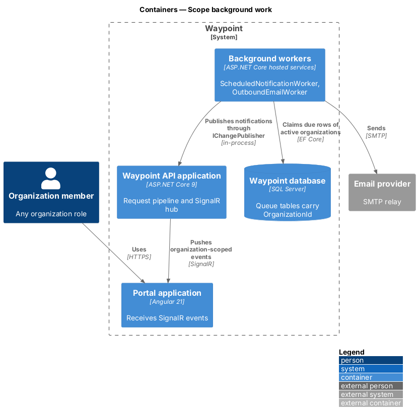
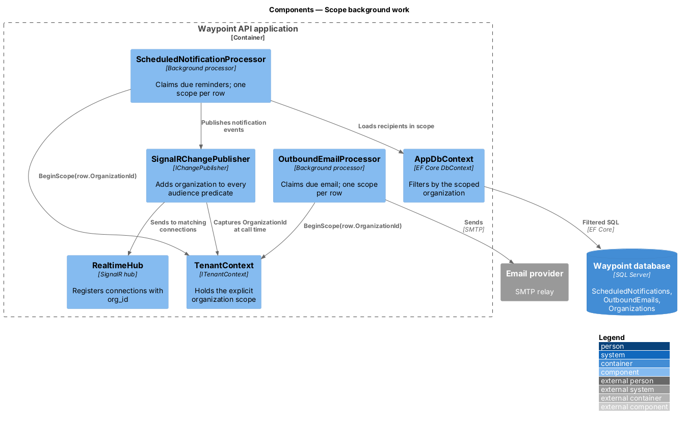
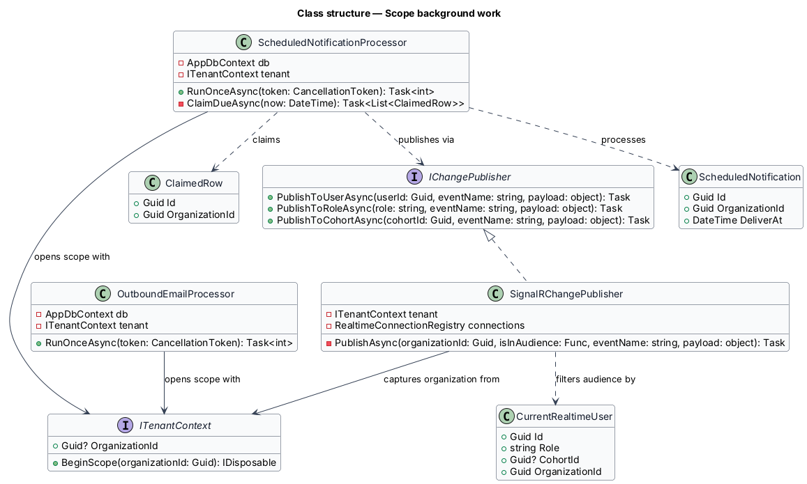
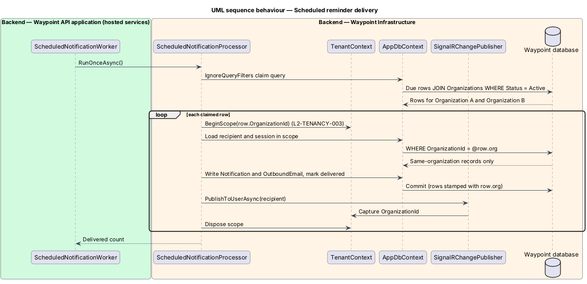
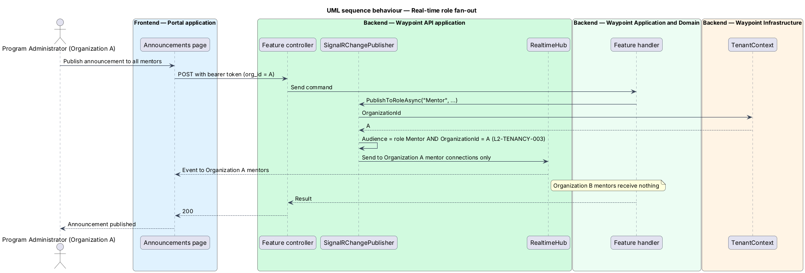

# Scope background work

## Overview

Waypoint is a youth-leadership software system for program intake, learning, mentoring, safeguarding, and program operations. The Multi-Tenancy subsystem lets one deployment serve many organizations while keeping each organization's records separate.

The [isolate-organization-data](../isolate-organization-data/README.md) slice scopes work that starts from an authenticated HTTP request. This slice scopes the remaining work. Some of it has no request behind it: scheduled reminders and outbound email. Some of it fans out beyond one response: real-time delivery. Some of it moves bulk data: CSV and PDF exports, bulk import, and stored files.

- **background processor** — hosted service that claims due rows from a queue table and processes them outside any HTTP request
- **organization scope** — interval during which `ITenantContext.OrganizationId` returns one fixed organization, opened with `BeginScope`
- **real-time audience** — set of open SignalR connections that receive one published event

## Description

### Vertical slice boundary

The slice changes the Waypoint API application and its hosted services. The Portal application does not change. The exports, imports, and file downloads already run inside authenticated requests, so the query filter from the isolation slice covers them. This slice adds tests that prove that coverage and fixes the code paths that bypass it.

### Components and types

| Layer | Components, types, and classes | Responsibility |
| --- | --- | --- |
| Infrastructure | [`ScheduledNotificationProcessor`](../../../../backend/src/Waypoint.Infrastructure/ScheduledNotificationProcessor.cs) | Claims due `ScheduledNotification` rows across all organizations with `IgnoreQueryFilters()`. It joins `Organization` and claims only rows whose organization is `Active`. It processes each row inside `BeginScope(row.OrganizationId)`. |
| Infrastructure | `OutboundEmailProcessor` ([source](../../../../backend/src/Waypoint.Infrastructure/OutboundEmailProcessor.cs)) | Applies the same claim-then-scope rule to `OutboundEmail` rows. |
| Infrastructure | [`ScheduledNotificationWorker`](../../../../backend/src/Waypoint.Infrastructure/ScheduledNotificationWorker.cs) [`OutboundEmailWorker`](../../../../backend/src/Waypoint.Infrastructure/OutboundEmailWorker.cs) | Unchanged hosted-service loops that call the processors. |
| Application port | [`IChangePublisher`](../../../../backend/src/Waypoint.Application/Shared/Abstractions/IChangePublisher.cs) | Signatures unchanged. Each publish call is bound to the caller's organization at call time. |
| API | [`SignalRChangePublisher`](../../../../backend/src/Waypoint.Api/Realtime/SignalRChangePublisher.cs) | Reads `ITenantContext.OrganizationId` when a publish method is called. It adds `state.OrganizationId == organizationId` to every audience predicate. It publishes nothing when the organization is null. |
| API | [`RealtimeHub`](../../../../backend/src/Waypoint.Api/Realtime/RealtimeHub.cs) | Records the connection's `org_id` claim in the connection registration. |
| API | `CurrentRealtimeUser` | Gains `Guid OrganizationId`, read with the existing per-event revalidation of account state. |
| Application | `ExportStandardReportQuery` ([source](../../../../backend/src/Waypoint.Application/ReportingAndData/DataTransfer/ExportStandardReportQuery.cs)) and the bulk-import handlers | Unchanged. They read and write through filtered sets, so the isolation slice stamps and filters them. |
| API | [`SubmissionFilesController`](../../../../backend/src/Waypoint.Api/Controllers/LearningExperience/SubmissionFilesController.cs) and user-file endpoints | Unchanged. They load `StoredSubmissionFile` and `StoredUserFile` through filtered sets, so another organization's file id returns `404`. |

### Functions and data flow

- Each processor's claim query is the only place in the processor that calls `IgnoreQueryFilters()`. The claim query selects ids together with each row's `OrganizationId`.
- For each claimed row, the processor opens `using var scope = tenant.BeginScope(row.OrganizationId)`. It then loads the row's recipients and content through filtered sets and sends.
- A notification or email therefore combines records from one organization only. A recipient from another organization is invisible inside the scope and is skipped.
- A suspended organization's rows stay unclaimed. When the organization is reactivated, rows that are still due are delivered on the next poll. The suspension slice owns that state change.
- `SignalRChangePublisher.PublishToRoleAsync(role, ...)` sends to connections whose user has that role in the publishing organization only. Before this slice, it sent to that role across the whole deployment.
- `PublishToUserAsync` and `PublishToCohortAsync` gain the same organization predicate as a second barrier. User and cohort ids are already unique.
- The publisher runs after commit through `AfterCommitDispatcher` in a new service scope. It captures the organization identifier as a value at call time, before the scope changes.

### Behavior

1. **Claim.** A worker tick claims due rows across active organizations.
2. **Scope.** Each row is processed inside its own organization scope.
3. **Deliver.** In-app notifications are written and email is sent, using recipients from that organization only.
4. **Fan out.** Real-time events reach connections of the same organization only.
5. **Export and import.** Requests run under the caller's organization through the query filter.

## Requirements

| L2 ID | Refines (L1) | Requirement |
|-------|--------------|-------------|
| `L2-TENANCY-003` | `L1-TENANCY-001` | Work not started by an HTTP request — scheduled jobs, notification and email dispatch, CSV/PDF exports, bulk import, and near-real-time message delivery — shall run under exactly one organization's scope. |

## Diagrams

### C4 system context

Figure 1 shows the outbound flows that this slice keeps inside one organization: email, in-app notifications, real-time events, and exported files.

*Figure 1 — C4 system context: Scope background work.*

### C4 container

Figure 2 separates the hosted background services from the request pipeline inside the Waypoint API application process.

*Figure 2 — C4 container view: Scope background work.*

### C4 component

Figure 3 shows the processors, the tenant context, and the real-time publisher, and where each applies the organization.

*Figure 3 — C4 component view: Scope background work.*

### Class structure

Figure 4 shows how the processors and the publisher depend on `ITenantContext`.

*Figure 4 — Class structure: Scope background work.*

### Sequence: scheduled reminder delivery

Figure 5 traces one worker tick that delivers reminders for two organizations without mixing their records.

*Figure 5 — Sequence behaviour: scheduled reminder delivery.*

### Sequence: real-time role fan-out

Figure 6 traces a role-targeted real-time event. It reaches the role inside the publishing organization only.

*Figure 6 — Sequence behaviour: real-time role fan-out.*
