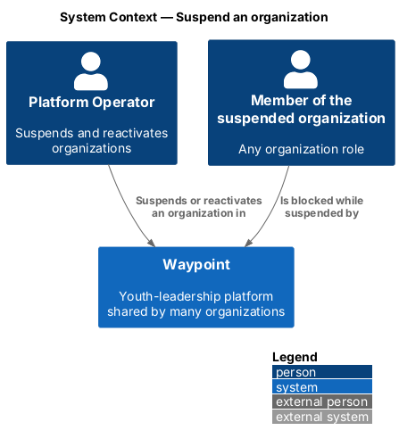
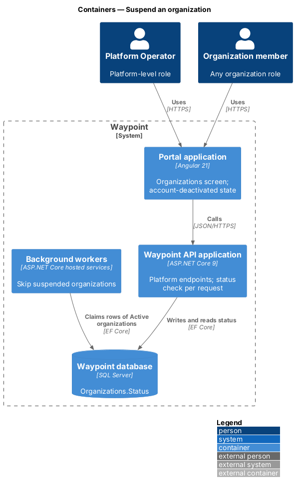
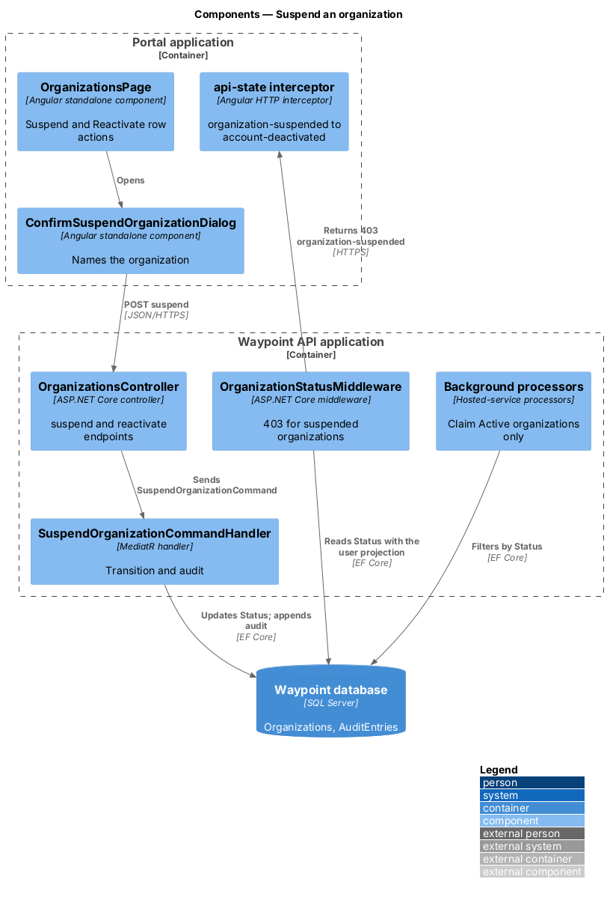
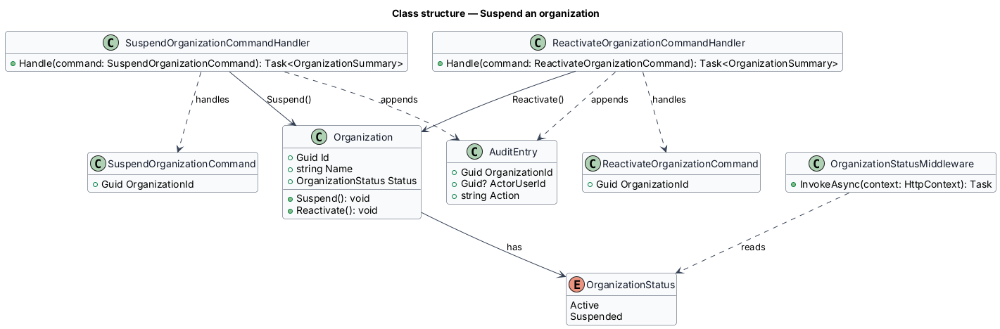
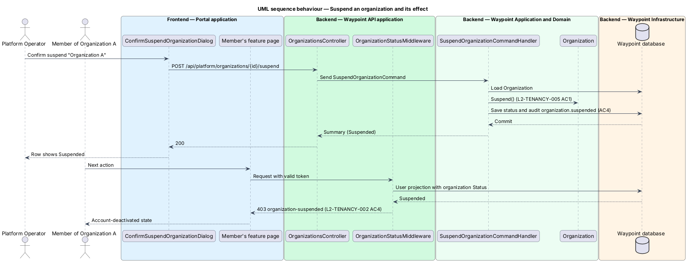

# Suspend an organization

## Overview

Waypoint is a youth-leadership software system for program intake, learning, mentoring, safeguarding, and program operations. The Multi-Tenancy subsystem lets one deployment serve many organizations while keeping each organization's records separate.

A Platform Operator uses this slice to suspend an organization. Suspension blocks all of the organization's users, for example when its licence lapses. It deletes no data. Reactivation restores access with every record unchanged.

- **suspension** — organization state in which its users cannot use Waypoint and its scheduled work does not run, while its data is retained unchanged
- **reactivation** — transition from suspended back to active that restores sign-in and scheduled work

The Organizations screen and the Platform Operator role come from [provision-organization](../provision-organization/README.md). The `403` response and the claim of active rows only come from [isolate-organization-data](../isolate-organization-data/README.md) and [scope-background-work](../scope-background-work/README.md).

## Description

### Vertical slice boundary

The slice adds two actions to the Organizations screen and two endpoints to the platform controller. It also adds the organization-status checks that make the state take effect: request rejection, sign-in rejection, and skipping background work.

### Components and types

| Layer | Components, types, and classes | Responsibility |
| --- | --- | --- |
| Frontend page | `OrganizationsPage` | Adds a Suspend action to each Active row and a Reactivate action to each Suspended row. Each row shows a state badge. |
| Frontend dialog | `ConfirmSuspendOrganizationDialog` | Names the organization and states that its users lose access immediately. It requires an explicit confirm. Focus returns to the row action on close. |
| Frontend API boundary | `OrganizationsService` | Adds `suspend(id)` and `reactivate(id)`. |
| API transport | `OrganizationsController` | Adds `POST /api/platform/organizations/{id}/suspend` and `POST /{id}/reactivate` under the `ManageOrganizations` policy. |
| Application | `SuspendOrganizationCommand` and `ReactivateOrganizationCommand` with handlers | Load the organization, apply the transition, write `organization.suspended` or `organization.reactivated` to the audit log, and save in one unit of work. The reactivation handler also cancels stale reminders in the same unit of work. |
| Domain | `Organization` | Gains `Suspend()` and `Reactivate()`. Each is a no-op when the organization is already in the target state, so retries are safe. |
| API | `OrganizationStatusMiddleware` | Introduced by the isolation slice. It reads `Organization.Status` from the same projection that `OnTokenValidated` loads. A suspended organization yields `403` with problem type `organization-suspended` on the next request (`L2-TENANCY-002` criterion 4). |
| Application | Sign-in handler | Rejects sign-in for a user of a suspended organization with the existing account-deactivated outcome. |
| Infrastructure | [`ScheduledNotificationProcessor`](../../../../backend/src/Waypoint.Infrastructure/ScheduledNotificationProcessor.cs) and `OutboundEmailProcessor` | Claim rows of `Active` organizations only. Rows of a suspended organization wait. |
| API | [`SignalRChangePublisher`](../../../../backend/src/Waypoint.Api/Realtime/SignalRChangePublisher.cs) | Includes organization status in its existing per-event revalidation and sends nothing to connections of a suspended organization. |

### Functions and data flow

- Suspension does not bump each user's `SessionVersion`. The per-request status check rejects existing tokens without writing to every user row, and reactivation restores them while they remain unexpired.
- Each request already loads one user projection in `OnTokenValidated`. This slice joins the organization status into that projection, so the status check adds no extra database round trip.
- Reminders that fall due during suspension stay unclaimed. On reactivation, `ReactivateOrganizationCommandHandler` cancels the organization's undelivered `ScheduledNotification` rows that fell due more than 24 hours earlier, by setting `CancelledAt`. A reminder for a session that has already happened is noise. Rows that are still due, or that fell due less than 24 hours ago, are delivered on the next poll (`L2-TENANCY-005` criterion 5). Queued `OutboundEmail` rows, such as invitations, are never cancelled and are sent on the next poll.

### Behavior

1. **Suspend.** The operator chooses Suspend and confirms in the dialog. The API sets `Suspended` and audits the change.
2. **Effect.** The next request from any of the organization's users returns `403`, and the Portal application shows the account-deactivated state. Sign-in fails the same way. Workers skip the organization's rows.
3. **Reactivate.** The operator chooses Reactivate. The API sets `Active` and audits the change. Users sign in again and see unchanged data.

## Requirements

| L2 ID | Refines (L1) | Requirement |
|-------|--------------|-------------|
| `L2-TENANCY-005` | `L1-TENANCY-002` | A Platform Operator shall be able to suspend an organization, which blocks all of its users without deleting any data, and later reactivate it. |

## Diagrams

### C4 system context

Figure 1 shows the Platform Operator suspending an organization and the effect on that organization's members.

*Figure 1 — C4 system context: Suspend an organization.*

### C4 container

Figure 2 shows that the state change is written by the API and read by the request pipeline and the background workers.

*Figure 2 — C4 container view: Suspend an organization.*

### C4 component

Figure 3 shows the components that change the organization state and the components that enforce it.

*Figure 3 — C4 component view: Suspend an organization.*

### Class structure

Figure 4 shows the state transitions on `Organization` and the commands that drive them.

*Figure 4 — Class structure: Suspend an organization.*

### Sequence: suspend and its effect

Figure 5 traces a suspension followed by the next request from a member of that organization.

*Figure 5 — Sequence behaviour: suspend an organization and its effect on a member.*
