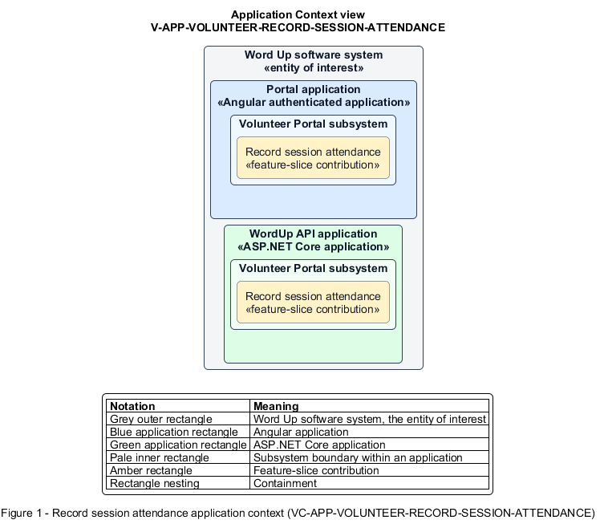

# Record session attendance

## Identification and scope

The Word Up software system is the entity of interest (EoI). The Record session attendance feature slice (`FS-VOLUNTEER-RECORD-SESSION-ATTENDANCE`) is an architecture description element in the Volunteer Portal subsystem.

| Item | Identification |
| --- | --- |
| Participating applications | Portal application; WordUp API application |
| Architecture view | Application Context view (`V-APP-VOLUNTEER-RECORD-SESSION-ATTENDANCE`) |
| Governing viewpoint | Application Context viewpoint (`VP-APP-CONTEXT`) |
| View component | Nested Application Context component (`VC-APP-VOLUNTEER-RECORD-SESSION-ATTENDANCE`) |

This focused description addresses feature scope, behavior, application context, and requirement correspondences. It does not claim conformance as a complete architecture description.

## Overview

The Record session attendance feature slice allows an assigned volunteer mark the minimum attendance data needed for one session.

## Application context

The Application Context view (`V-APP-VOLUNTEER-RECORD-SESSION-ATTENDANCE`) applies the Application Context viewpoint (`VP-APP-CONTEXT`) to the Word Up software system. The viewpoint frames the application-location concern (`C-APP-LOCATION`). The view component (`VC-APP-VOLUNTEER-RECORD-SESSION-ATTENDANCE`) uses the nested-containment model kind.

Nested rectangles identify the EoI, each participating application, the subsystem boundary, and the feature-slice contribution. Figure 1 presents the view component.

*Figure 1 — Application Context view: the Record session attendance feature slice within the participating Word Up applications.*

## Behavior

- **Entry.** A volunteer opens Attendance for today's assigned session.
- **Processing.** The server returns youth names only; the UI supports Present, Absent, and All present, works with the protected offline queue, and rejects every out-of-scope resource or status.
- **Result.** Attendance persists without revealing youth progress, grades, risk, or other records.

## Scope boundary

Mentor attendance has a richer status set; offline replay integrity is a shared platform capability.

## Correspondences

The requirement-trace correspondence method (`M-REQ-TRACE`) relates stable L2 requirement identifiers to feature slices. The Record session attendance requirement correspondence (`COR-REQ-VOLUNTEER-RECORD-SESSION-ATTENDANCE`) records the following relationships.

| Requirement | Relationship |
| --- | --- |
| `L2-VOLUNTEER-001` | Primary requirement |
| `L2-NFR-004` | Dependency |
| `L2-AUTH-010` | Dependency |
| `L2-PLATFORM-006` | Dependency |
