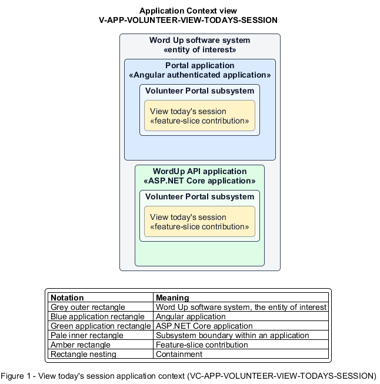

# View today's session

## Identification and scope

The Word Up software system is the entity of interest (EoI). The View today's session feature slice (`FS-VOLUNTEER-VIEW-TODAYS-SESSION`) is an architecture description element in the Volunteer Portal subsystem.

| Item | Identification |
| --- | --- |
| Participating applications | Portal application; WordUp API application |
| Architecture view | Application Context view (`V-APP-VOLUNTEER-VIEW-TODAYS-SESSION`) |
| Governing viewpoint | Application Context viewpoint (`VP-APP-CONTEXT`) |
| View component | Nested Application Context component (`VC-APP-VOLUNTEER-VIEW-TODAYS-SESSION`) |

This focused description addresses feature scope, behavior, application context, and requirement correspondences. It does not claim conformance as a complete architecture description.

## Overview

The View today's session feature slice provides a volunteer only the logistics needed for today's assigned session.

## Application context

The Application Context view (`V-APP-VOLUNTEER-VIEW-TODAYS-SESSION`) applies the Application Context viewpoint (`VP-APP-CONTEXT`) to the Word Up software system. The viewpoint frames the application-location concern (`C-APP-LOCATION`). The view component (`VC-APP-VOLUNTEER-VIEW-TODAYS-SESSION`) uses the nested-containment model kind.

Nested rectangles identify the EoI, each participating application, the subsystem boundary, and the feature-slice contribution. Figure 1 presents the view component.

*Figure 1 — Application Context view: the View today's session feature slice within the participating Word Up applications.*

## Behavior

- **Entry.** An authenticated volunteer opens Volunteer Home.
- **Processing.** The server returns at most the volunteer's assigned session with schedule, location, status, and roster count while excluding youth progress, records, messages, and safeguarding flags.
- **Result.** The volunteer can prepare for the session and continue to attendance when allowed.

## Scope boundary

The schedule history and youth-name attendance list are separate slices.

## Correspondences

The requirement-trace correspondence method (`M-REQ-TRACE`) relates stable L2 requirement identifiers to feature slices. The View today's session requirement correspondence (`COR-REQ-VOLUNTEER-VIEW-TODAYS-SESSION`) records the following relationships.

| Requirement | Relationship |
| --- | --- |
| `L2-VOLUNTEER-001` | Primary requirement |
| `L2-AUTH-010` | Dependency |
