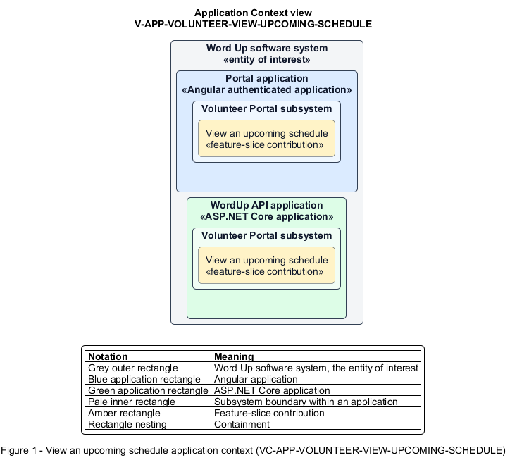

# View an upcoming schedule

## Identification and scope

The Word Up software system is the entity of interest (EoI). The View an upcoming schedule feature slice (`FS-VOLUNTEER-VIEW-UPCOMING-SCHEDULE`) is an architecture description element in the Volunteer Portal subsystem.

| Item | Identification |
| --- | --- |
| Participating applications | Portal application; WordUp API application |
| Architecture view | Application Context view (`V-APP-VOLUNTEER-VIEW-UPCOMING-SCHEDULE`) |
| Governing viewpoint | Application Context viewpoint (`VP-APP-CONTEXT`) |
| View component | Nested Application Context component (`VC-APP-VOLUNTEER-VIEW-UPCOMING-SCHEDULE`) |

This focused description addresses feature scope, behavior, application context, and requirement correspondences. It does not claim conformance as a complete architecture description.

## Overview

The View an upcoming schedule feature slice allows a volunteer see only their future assigned sessions.

## Application context

The Application Context view (`V-APP-VOLUNTEER-VIEW-UPCOMING-SCHEDULE`) applies the Application Context viewpoint (`VP-APP-CONTEXT`) to the Word Up software system. The viewpoint frames the application-location concern (`C-APP-LOCATION`). The view component (`VC-APP-VOLUNTEER-VIEW-UPCOMING-SCHEDULE`) uses the nested-containment model kind.

Nested rectangles identify the EoI, each participating application, the subsystem boundary, and the feature-slice contribution. Figure 1 presents the view component.

*Figure 1 — Application Context view: the View an upcoming schedule feature slice within the participating Word Up applications.*

## Behavior

- **Entry.** A volunteer opens Schedule.
- **Processing.** The server scopes upcoming sessions to the authenticated volunteer and the UI presents their dates, logistics, and status with a clear empty state when none are assigned.
- **Result.** The volunteer knows their upcoming commitments without gaining access to other schedules or youth records.

## Scope boundary

Creating sessions and editing assignments are staff functions outside the portal.

## Correspondences

The requirement-trace correspondence method (`M-REQ-TRACE`) relates stable L2 requirement identifiers to feature slices. The View an upcoming schedule requirement correspondence (`COR-REQ-VOLUNTEER-VIEW-UPCOMING-SCHEDULE`) records the following relationships.

| Requirement | Relationship |
| --- | --- |
| `L2-VOLUNTEER-002` | Primary requirement |
| `L2-AUTH-010` | Dependency |
| `L2-ENGAGE-001` | Dependency |
